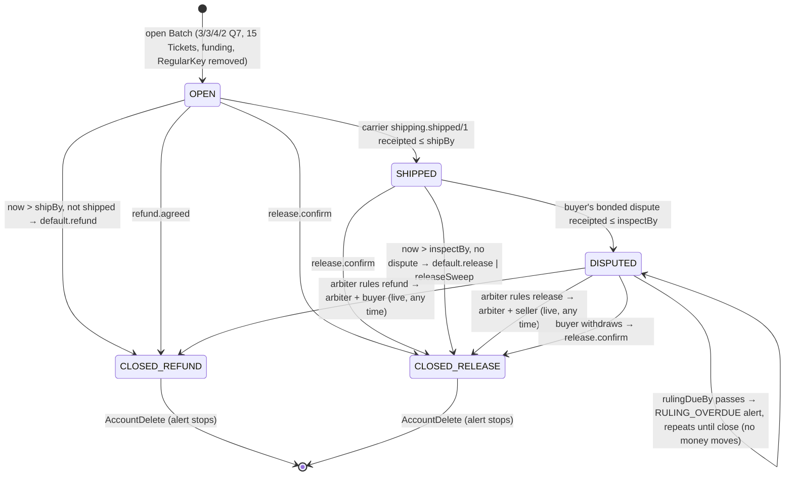

# marketplace-escrow@1: escrowed marketplace purchase (product spec v3, final for Developer 1)

Status: v3 written 2026-11-21 at ~18:30 (Asia/Jerusalem). Every decision in it was approved by Naor at 18:16, as relayed by Dev Lead. This is a spec only: no repo changes, PRs or posts. It was read against `origin/main` @ `feb8148`.

The template draft is `/workspace/specs/marketplace-escrow@1.draft.json`. The repo validator passes it with 15 Tickets and 4.4 XRP (§7).

Citations use the form `path:line`. **[inference]** marks my own reasoning. **[decided]** marks Naor's decisions (§11).

**Naming.** Each identifier for this template is a single token:

| Kind | Identifier |
|---|---|
| Template id | `settlement-vault/marketplace-escrow@1` |
| Template file | `templates/marketplace-escrow@1.json` |
| Policy | `pol_marketplace-escrow@1.0.0` (`policies/marketplace-escrow@1.0.0.json`) |
| Flow class and directory | `MarketplaceEscrowFlow`, `packages/cosigner/src/marketplace-escrow/flow.ts` |
| Register check | `marketplaceEscrowTermsFindings` |
| npm scripts | `demo:marketplace-escrow`, `demo:marketplace-escrow-dispute` |
| Testnet case labels | `ME1`–`ME20` |

`M1`–`M4` were not usable as labels: the MPP demo already uses them (`docs/demo/mpp-purchase.md:132-135`).

**"Purchase" in prose.** It means the deal concept only: an agent buying an item from a marketplace seller. It is never an identifier. The repo already uses "purchase" for the x402 and MPP *spend* demos (`docs/demo/x402-purchase.md`, `docs/demo/mpp-purchase.md`, `docs/SCOPE.md:58-59`). Those run on owner-wallet templates and are unrelated to this escrow.

## Changelog

**v3 (2026-11-21, after Naor approved all 11 picks):**
- Renamed `purchase@1` to `marketplace-escrow@1` in every identifier, file name and case label (cases are now `ME1`–`ME20`).
- All open questions became the decisions table (§11).
- **Q10:** the carrier's signing key is now judged at receipt time, reusing the §4.2 receipt map (§4.1 step 6, §4.2). The "no key rotation" operating rule is removed.
- **Q11:** Option A is decided. The ruling-overdue alert now continues until the account is deleted; a receipted ruling no longer stops it (§4.4, §5).
- ME12–ME14 moved from the Testnet demo to unit tests.
- Work breakdown updated: 9.25 days, plan 8–10 (§9).
- v2 files moved to `/workspace/specs/archive/` (unchanged).

**v2 (2026-11-21):** Fixed Dev Lead's four blocking findings (attester intake, receipt-time freshness, generic disputes, overdue alert), applied all non-blocking fixes, recorded the late-ruling finding, and added the code-change and work-breakdown sections.

**v1 (2026-11-21):** Initial spec.

## 1. Purpose and user story

An AI buyer agent pays a marketplace seller in RLUSD.
- If the seller never ships, the buyer is refunded.
- If the item ships and nobody disputes by the inspection deadline, the seller is paid without anyone acting.
- If the buyer disputes, an accredited arbiter decides, and release stays blocked until it does.

This is the README wedge, "recourse for agent payments on XRPL... for payment platforms and x402 facilitators" (`README.md:3`), applied to the commonest agent-commerce shape.

- **[decided]** hotel@2 is frozen as experimental/legacy, and there will be no hotel@3. Hotel is already Research (`docs/trust-model.md:5`), and "no new hotel features are merged" (`docs/SCOPE.md:11`).
- **Precedent.** Catalog R3 already sketches this deal (`docs/use-cases/catalog.md:65-76`; SCOPE v1.1, `docs/SCOPE.md:33`). marketplace-escrow@1 is the R3 subset, without delivery-anchored inspection and without conditional rulings.

## 2. Roles, weights, quorum

| Role key | Who | Weight | operatedBy |
|---|---|---|---|
| `principal` | Buyer agent. **[decided]** It signs with the agent's own key, acting under its owner's signed `party.mandate/1` | 3 | external |
| `counterparty` | Seller | 3 | external |
| `arbiter` | Accredited arbiter, `accreditation: "service"` (V15, `packages/core/src/template.ts:269-273`) | 4 | external |
| `cosigner` | Policy co-signer (service) | 2 | service |
| Quorum | | **7** | |

These are the hotel@2 weights (`templates/hotel@2.json:7-12`). The validator on the draft gives:
- minimal winning sets `{counterparty, arbiter}`, `{principal, arbiter}` and `{principal, counterparty, cosigner}`;
- only the V10 disclosure.

| Set | Weight | ≥7? | Used by |
|---|---|---|---|
| buyer + seller + co-signer | 8 | ✅ | release.confirm, refund.agreed, pre-signed defaults (the blob carries 6; the co-signer adds 2) |
| arbiter + buyer | 7 | ✅ | dispute.refund (live) |
| arbiter + seller | 7 | ✅ | dispute.release (live) |
| buyer + seller | 6 | ❌ | none |
| arbiter + co-signer | 6 | ❌ | none (V11, `template.ts:229-236`) |
| buyer + co-signer, seller + co-signer | 5 | ❌ | none |

- **Collusion.** The only pair without the arbiter or the co-signer is buyer + seller, and it fails at 6. The residual risk is a non-neutral arbiter plus one party. It is disclosed (V10) and limited by the register-time accreditation check (`docs/trust-model.md:76-80`) and the arbiter SLA (§5).
- **Why the weights stay as they are.**
  - Arbiter at 3: both `dispute.*` sets fall to 6, so they fail **V4** (`template.ts:160-169`). V3 still passes, because {buyer, seller, arbiter} = 9.
  - Co-signer at 3: arbiter + co-signer = 7, so the service plus the arbiter could move funds with no party.
  - Party weight at 4: buyer + seller = 8, so the parties could skip the co-signer.
  - 3/3/4/2/7 is the shipped, tested shape (`packages/core/test/core.test.ts:84-86`).
- **[decided] Buyer key risk [inference].** A compromised agent key cannot release funds alone. Every release path also needs the seller plus the co-signer, and the co-signer checks the payout against the owner's mandate. An attacker holding the key could still dispute, or confirm release to the mandated seller. That bounded risk should be disclosed to platforms.

## 3. Dates and evidence

| Term | Template default | Meaning |
|---|---|---|
| `shipBy` | open + 72 h (259200 s; the R3 figure, `catalog.md:68`) | Latest a shipment can be receipted. At expiry, if nothing is shipped, `default.refund` runs |
| `inspectBy` | open + 10 d (864000 s) | Last time to dispute. At expiry, if shipped and undisputed, `default.release` or `default.releaseSweep` runs |
| `rulingDueBy` | dispute opened + 5 d (432000 s) | Arbiter SLA only. `onExpire: "escalate"` raises the §4.4 alert and moves no money |

**[decided]** Both deal timers are absolute values in `record.timers`, fixed at open. inspectBy is not anchored on delivery. `ingest()` already judges windows against `record.timers[window]` (`packages/cosigner/src/service.ts:398-410`).

**Register-time checks.** A new `marketplaceEscrowTermsFindings` runs at `register()`, beside hotel's `stayTermsFindings` (`service.ts:303`). It checks **the deal's own `record.timers`**:
1. `open < shipBy < inspectBy`.
2. `shipBy − open ≥ params.minShipWindow` (proposed 24 h).
3. `inspectBy − shipBy ≥ params.minInspectGap` (proposed 7 d). The gap must cover transit plus inspection. A buyer whose parcel hasn't arrived disputes "not received" before inspectBy.
4. `record.attesters.shipping.accounts` names the carrier attester account(s). The attester is named by account, not accepted by kind (§4.1).
5. If an `ENG/ATTESTER/SHIPPING` credential is present, its expiry must be ≥ inspectBy.
6. The amount is ≤ the mandate maximum, and the seller is the mandate payee.
7. The existing arbiter neutrality check (`NOT_NEUTRAL`) still runs.
8. `terms.rulingWindow` is absent. The SLA lives in the template timer (§5).

**Template-level ordering check.** Extend V14 with the required reason argument (`template.ts:261`):
`ordered('shipBy', 'inspectBy', true, 'the buyer must be able to inspect after the last possible shipment')`. Both timers run `from: "open"` (`template.ts:262-263`). Demo policy copies shorten the bounds, as the hotel demo does (`packages/cosigner/demo/README.md:41`).

**"Shipped" evidence [decided].** A `shipping.shipped/1` statement from the carrier attester named in the terms.
- The registry sets `selfAttest: 'never'` (`packages/policy/src/pipeline.ts:18`; `docs/spec/attestations.md:48`, `:211`).
- A seller-signed shipment is therefore rejected `SELF_ATTESTED` (`pipeline.ts:111-112`).
- The demo runs a stand-in carrier attester, the way the hotel script stands in an accreditor (`packages/cosigner/demo/README.md:39`).

## 4. Blocking code changes (all verified at feb8148)

### 4.1 Attester intake

**Problem.**
- `ingestLocked` throws `NOT_A_PARTY` for any non-party attester (`service.ts:391-392`).
- `decideDraft` drops unreceipted window-governed statements passed in at decide time as `NOT_RECEIPTED` (`service.ts:859-866`; `windowGoverned`, `service.ts:1091-1094`).
- `tickLocked` evaluates stored blobs against stored statements only (`service.ts:726-750`).

As a result a shipment could never count.

**Spec.**
1. **Intake.** `ingestLocked` accepts an attester that is a party **or** is listed in `record.attesters[*].accounts`, extending the check at `service.ts:392`.
   - Attesters known only by accreditation kind are **not** accepted at intake. That follows attestations D7, "attesters are deal terms" (`docs/spec/attestations.md:47`).
2. **Type allowlist.** Add an optional `types?: string[]` to `AttesterTerms` (`packages/policy/src/types.ts:36-40`).
   - This template sets `attesters.shipping = { accounts: [...], kind: "SHIPPING", types: ["shipping.shipped/1"] }`.
   - Absent means no extra restriction, so existing records are unaffected.
3. **Authentication.** Unchanged and reused:
   - signature (`verifyStatement`, `service.ts:386-387`);
   - key authorization at the receipt ledger, which already snapshots the attester (`service.ts:394-395`; `keyAuthorized`, `pipeline.ts:59-65`);
   - role, binding, time and `SELF_ATTESTED` via `verifyStatements` at receipt (`service.ts:425-426`);
   - window deadline, inclusive (`service.ts:406-409`);
   - `STALE_ISSUED`, 300 s (`service.ts:136`, `:421-422`).
   - HTTP intake is the existing ingest `POST` (`server.ts:161`). The statement signature authorizes; the bearer token only gates the API.
4. **Sequence rules,** added to `checkSequence` and gated on this template:
   - a shipment received before open is rejected;
   - only the first receipted shipment counts (`ALREADY_SHIPPED`);
   - `party.dispute/1` is accepted only from `template.dispute.by` (§4.3).
5. **Receipting and storage.** Unchanged. A signed `cosigner.receipt/1` carries `receivedAt` and `ledgerIndex` (`service.ts:428-436`) and is persisted before return (`service.ts:437`). Receipts are restored on boot (`README.md:163`).
6. **Carrier key judged at receipt [decided, Q10].**
   - Today `decide()` re-runs `keyAuthorized` at the evaluation ledger (`pipeline.ts:59-65` via `decide.ts:41-42`), so a carrier key rotation between shipment and inspectBy would drop the shipment.
   - With the §4.2 receipt map, the decision-time key check is skipped for a statement that is (a) receipted, (b) of a window-governed type, and (c) from a **non-party named attester**. The receipt already proved key authorization at the receipt ledger (`service.ts:425`).
   - Party statements, hotel's included, keep today's decision-time key check, so hotel behaviour is unchanged.
   - The "no rotation while deals are open" operating rule from v2 is removed.

### 4.2 Receipt-time judgement for receipted attester statements

**Problem.**
- `shipping.shipped/1` has `maxLagSecs` 86400 (`pipeline.ts:18`).
- STALE is measured against the evaluation ledger's close time (`pipeline.ts:77`, `:108`).
- `decide()` re-verifies every statement at decision time (`decide.ts:41-42`).

So a shipment older than a day would go STALE before shipBy or inspectBy.

**Choice: receipt time, not memo anchoring.**
- The co-signer already verifies at receipt (`service.ts:425`), and it signs and persists `receivedAt` (`service.ts:432`, `:437`).
- Memo anchoring (step 4) is not implemented (`pipeline.ts:1-3`). It would need an on-ledger transaction and XRP from the carrier for every statement.
- Caveat: attestations D5 says unanchored statements are checked at the evaluation ledger (`docs/spec/attestations.md:45`). Treating the signed receipt as the anchor is a deliberate, narrow extension of D5, and §11 includes the matching docs edit.

**Spec.**
- `verifyStatements` gains an optional `receipted: Map<statementId, { receivedAt, attesterIsParty }>`, which `decideDraft` builds from `st.attestations`.
- For a receipted statement of a window-governed type:
  - **maxLag** (`pipeline.ts:108`) compares `observedAt` against `receivedAt`;
  - **key authorization** (`pipeline.ts:59-65`) is skipped when the attester is not a party (§4.1 step 6).
- Everything else stays at the evaluation ledger: signature, roles, binding, future-dating, `validUntil`, `SELF_ATTESTED`, consumption and supersession.

**No hotel or B1 regression.**
- hotel@2's window-governed types (`templates/hotel@2.json:33-41`) all have `maxLagSecs: null` (`pipeline.ts:29-39`). They are all party statements, so the key-check change never applies to them.
- procurement@1 has no `attestationWindows`, so `approval.payment/1` (maxLag 3600) is untouched.
- Regression tests:
  - the hotel suites (`packages/cosigner/test/hotel-service.test.ts`, `hotel-service.sweep.test.ts`) pass unchanged;
  - a stored, non-window-governed `approval.payment/1` still goes STALE after 1 h;
  - a hotel party statement whose key was rotated after receipt still behaves as today;
  - a receipted `shipping.shipped/1` observed 3 days before inspectBy still counts;
  - a receipted shipment still counts after the carrier rotates its RegularKey.

### 4.3 Generic, template-declared disputes

**Problem.**
- `disputeBonded` adds the hotel confirmation deposit for any non-`entry` phase and fails when there is no confirmation (`service.ts:601-615`). This template's disputes would therefore throw `NOT_BONDED` (`service.ts:494`).
- The policy's `disputeOpen` is hotel-specific (`policies/hotel@2.0.0.json:48`).
- The hotel rules in `checkSequence` run for every template (`service.ts:451-532`).

**Spec.**
- The optional template field in the draft:
  ```json
  "dispute": { "by": ["principal"], "bond": { "base": "amount", "plusParam": "minDisputeBond" }, "lateRuling": "accept", "overdueTimer": "rulingDueBy" }
  ```
- When present, `disputeBonded` requires:
  - the `by` party's `ENG/DISPUTE` Credential (`service.ts:605`);
  - a balance ≥ `amount + minDisputeBond`.
  
  `caseOpenedAt` uses the dispute's `issuedAt` with no hotel anchors, and the hotel phase rules are skipped.
- When absent, today's path runs unchanged. hotel@1 and hotel@2 are **not** edited: a new template hash would quarantine open deals as `ENGAGEMENT_STALE` (`README.md:164`).
- **[decided] Seller disputes.** One dispute per deal, and only from `by`. A seller's `party.dispute/1` is refused `NOT_DISPUTANT`. Today a counterparty dispute skips the bond check (`service.ts:461`, `:494`); `by` closes that gap for this template.
- **Policy side.** `pol_marketplace-escrow@1.0.0` defines its own `disputeOpen`: `size(att.list('party.dispute/1','principal')) > 0 && balance >= amount + minDisputeBond`.
- **Hotel regression tests.**
  - The existing dispute tests stay green (`hotel-service.sweep.test.ts:102-151`, `scheduler.test.ts:35`).
  - An entry dispute still needs room + bond.
  - A settlement dispute still needs room + deposit + bond.
  - A counterparty dispute behaves as today.
  - The hotel@2 `LATE` ruling refusal is unchanged (§5).

### 4.4 Ruling-overdue alert

**Problem.**
- `escalate` exists only as the validator's V6 skip (`template.ts:188`) and in a doc comment (`template.ts:40`).
- The scheduler ticks only stored blobs (`packages/cosigner/src/scheduler.ts:6-12`, `:41-95`).
- `tickLocked` returns early when a deal has no blobs (`service.ts:728`).

**Spec (ops only, never a ledger action) [decided, Q11].**
1. `CosignerService.overdue(engagementId)` returns `{ alert: 'RULING_OVERDUE', engagementId, caseOpenedAt, dueAt, rulingReceipted }` when all of these hold:
   - `template.dispute.overdueTimer` names a timer with `onExpire: "escalate"`;
   - a receipted dispute exists;
   - the validated close time is past `caseOpenedAt + durationSecs`;
   - **the engagement account still exists**.
2. A receipted ruling does **not** stop the alert. It continues until the account is deleted, so a ruling that has been receipted but never signed and submitted by the arbiter and the winning party still pages. `rulingReceipted` tells ops which side is stuck: no ruling yet, or a ruling that hasn't been executed.
3. The scheduler round calls `overdue()` for every open engagement, independent of stored blobs, and passes hits to a new `TickSchedulerOptions.onAlert`.
4. The service persists `alertedAt` and re-raises every `params.rulingOverdueRepeat` (proposed 24 h).
5. `server.ts` writes a structured `level: "error", msg: "ruling overdue"` log line, plus an optional `COSIGNER_ALERT_WEBHOOK` POST.
6. No decision record is signed and no blob is touched.
7. Tests:
   - fires once at the deadline;
   - repeats after the interval;
   - **keeps firing after a receipted ruling**;
   - stops when the account is deleted;
   - never yields a SIGN.

## 5. Late rulings [decided: Option A]

**Finding (v2, verified).**
- `ingestLocked` refuses to *receipt* a `party.ruling/1` received after `rulingDeadline` (`service.ts:417-419`). That deadline exists only when a `rulingWindow` is set (`service.ts:562-573`).
- A late ruling is still executable on-ledger. `dispute.refund` and `dispute.release` are arbiter + party = 7 with `enforcement: "none"`. The co-signer neither signs nor gates them (`signsStage`, `service.ts:929-933`), and no code reads `requires: "ruling"`.

**Decision.** The `LATE` check runs only when `template.dispute?.lateRuling !== 'accept'`. This template sets `accept`. hotel@2 has no `dispute` block, so it keeps the refusal, and a regression test asserts that. The policy also omits `params.rulingWindow`, and register rejects `terms.rulingWindow`, as defence in depth.

**Operational flow.**
1. The dispute opens, and `default.release` refuses `DISPUTE_OPEN` on every tick.
2. At `rulingDueBy` ops are paged, and keep being paged until the account is deleted (§4.4).
3. The arbiter rules whenever it rules, and the ruling is receipted.
4. The arbiter and the winning party sign the close, the account is deleted, and the alert stops.

No default ever fires on arbiter silence.

**Arbiter SLA [decided].**
- No backup arbiter and no arbiter-silent fallback; an arbiter outage is treated like a card-network outage.
- The trust model documents the ruling SLA (`rulingDueBy`), the uptime and redundancy of the arbiter operation, paging, and key continuity. **[inference]** The arbiter can rotate its account's RegularKey without touching the deal SignerList; verify on Testnet.
- **[decided]** Rulings are full refund or full release only, as an arbiter conduct rule plus a `party.ruling/1` schema constraint, disclosed to the principal. The ledger can't enforce it, because the ruling set isn't co-signed.

## 6. Outcomes, policy stages, state machine

Each outcome is a settle-and-close ALLORNOTHING Batch that ends with `AccountDelete` (`README.md:94-99`). V7 caps a Batch at 8 inner transactions (`template.ts:198-206`).

| Outcome | Trigger | Signers | Pre-signed? | Blueprint | Tickets |
|---|---|---|---|---|---|
| `release.confirm` | Buyer confirms (any time before close; also how a dispute is withdrawn) | buyer + seller + co-signer (`ledger`) | live | `close.split`: price − fee to the seller, the fee, the rest to the buyer | 0 |
| `refund.agreed` | Mutual cancel or seller concession | buyer + seller + co-signer | live | `close.refundAll` | 0 |
| `default.refund` | `now > shipBy` with no receipted shipment | blob: buyer + seller; final signature: co-signer | yes, at open | `close.refundAll`: whole balance to the buyer | 4 |
| `default.release` | `now > inspectBy`, shipped, no open dispute, balance == price | as above | yes, at open | `close.releaseAll` | 5 |
| `default.releaseSweep` | same, but balance > price; the extra goes to the buyer | as above | yes, at open | `close.releaseWithSweep` | 6 |
| `dispute.refund` | Arbiter rules for the buyer | arbiter + buyer (`none`) | live, any time | `close.refundAll`: price + bond to the buyer | 0 |
| `dispute.release` | Arbiter rules for the seller | arbiter + seller (`none`) | live, any time | `close.split`: price − fee + bond to the seller **[decided: bond to the winner]** | 0 |

**[decided] The extra-money release copy stays.**
- An exact payout with extra RLUSD in the account leaves a trust-line balance, so `AccountDelete` fails (`docs/use-cases/hotel-booking.md:521`).
- A zero-delivery sweep also fails and burns the default (`README.md:142`).
- So there are two blobs on one stage, using the hotel@2 N8 pattern (`policies/hotel@2.0.0.json:265-271`). `PAYOUT_MISMATCH` includes `tx.payouts.hasResidual() == (def.balance > def.price)`, so exactly one variant passes.
- A trust-line cap at the price would instead block the dispute bond.

**Policy stages, `pol_marketplace-escrow@1.0.0`.**

| Stage | Rules |
|---|---|
| `default.refund` | `NOT_DUE` (now > shipBy); `SHIPPED`; `TX_SHAPE`; `PAYOUT_MISMATCH` (toBuyer == balance). **No dispute check**: refund is the never-performed outcome (ME18) |
| `default.release` | `NOT_DUE` (now > inspectBy ∧ shipped); `NOT_SHIPPED`; `DISPUTE_OPEN` (cleared only by account close, never by time); `BALANCE_CHANGED`; `TX_SHAPE`; `PAYOUT_MISMATCH` with the N8 residual clause. **No equivalent of hotel L5's lapse clause** (`policies/hotel@2.0.0.json:307-310`) |
| `release.confirm` | seller + fee == price; fee == bps; payees ⊆ {buyer, seller, fee account} (compare S2/S4/S6, `policies/hotel@2.0.0.json:121-150`) |
| `refund.agreed` | `TX_SHAPE` refundAll; full balance to the buyer |
| baseline | B11 `wouldSucceed`, no `SetRegularKey`, fee cap (`docs/trust-model.md:50`) |
| params | `serviceFeeBps` 50, `minDisputeBond`, `minShipWindow`, `minInspectGap`, `rulingOverdueRepeat`. **No `rulingWindow`** |

All defaults are pre-signed before the open Batch (`README.md:92`), which reserves all the Tickets (`README.md:88`). Unused Tickets die at `AccountDelete` (`README.md:99`). The tick iterates stored blobs generically (`service.ts:726-750`).



**Not included in v1.**
- **Arbiter-silent defaults.** hotel@2's chargeback outcomes and its `rulingDueBy` onExpire list (`templates/hotel@2.json:21-23,31`), and cases H8 and H17 (`packages/cosigner/demo/README.md:60,69`).
- **Claim lapse.** Hotel's L5.
- **Backup arbiter.**
- **Any other non-responsive-party default.**
- **[decided] Seller disputes.**
- **[decided] shipBy extension or amendments.** `party.amendment/1` is registered (`pipeline.ts:39`) but has no intake logic.
- **Partial or conditional rulings** (`catalog.md:76`).
- **Delivery-anchored inspection.**

## 7. Tickets, reserve, asset

**Tickets and reserve.** Tickets = Σ pre-signed outcomes × (1 + inner steps) (`template.ts:210`). Reserve = 1 XRP + 0.2 XRP × (trust line + SignerList + Tickets) (`template.ts:214-217`, `docs/costs.md:7-9`).

| Deal | Tickets | Reserve |
|---|---|---|
| **marketplace-escrow@1** (validator re-run on the renamed v3 draft) | 4 + 5 + 6 = **15**, flat | **4.4 XRP** |
| hotel@2 minus arbiter-silent defaults (`flow.ts:87-90`) | 21 | 5.6 XRP |
| hotel@2 today, 1 night / 14 nights | 31 / 109 | 7.6 / 23.2 XRP (`docs/costs.md:30-32`) |

- **Pre-create funding.** About 5.4 XRP, following hotel's reserve + 1 XRP pattern (`flow.ts:177`).
- **Burned per deal.** About 0.2 XRP (`docs/costs.md:91`).
- **XLS-68 doesn't help.** It cannot sponsor Tickets (`README.md:384`).

**Asset: Ripple's Testnet RLUSD for the demo and Clip 3; a run-created issuer for unit tests and CI.**

Why Ripple's RLUSD:
- t54 settles it (`packages/cosigner/demo/x402/facilitator.ts:7-8`).
- Using it removes the storyboard's "Not Ripple's RLUSD" card (`docs/demo/n2a-storyboard.md:28`, `:60`; `hotel-dispute-testnet.ts:39`).
- The issuer is the deploy slot `$slot:rlusd.issuer` (`policies/hotel@2.0.0.json:15`), and the pool CLI defaults to Ripple's issuer (`pool-cli.ts:34`).

How the demo gets it:
- The repo has no RLUSD faucet.
- The t54 script sets trust lines (`b1-x402-t54-testnet.ts:115-117`), then buys via `ripple_path_find` under a 50 XRP cap (`:123-135`).
- My Testnet read on 2026-11-21 at ~17:58 IST: AMM ≈13.6 XRP/RLUSD.
- **[decided]** The item is about 2 RLUSD and the bond about 0.5 RLUSD. The 2 RLUSD buy is ≈27 XRP, under the 50 XRP cap. The bond is a separate ≈7 XRP buy.
- The Testnet faucet amount per wallet is unverified.

**Issuer disclosure.**
- My read of the issuer flags: `requireAuthorization: false` and no `TransferRate`.
- To disclose: **`allowTrustLineClawback: true`** and **`noFreeze: false`**. The second means Ripple can freeze individual trust lines or freeze globally (`README.md:247`).
- ME16 proves the close works with Ripple's issuer. The fallback is a run-created issuer, in which case the storyboard card stays.

## 8. Code changes in scope (for Developer 1)

| # | Change | Files |
|---|---|---|
| C1 | Template; optional `dispute` field on `Template`; V14 `ordered('shipBy','inspectBy', true, <reason>)` plus tests | `templates/marketplace-escrow@1.json`, `packages/core/src/template.ts`, `packages/core/test/` |
| C2 | Attester intake (§4.1): named-account attesters, `AttesterTerms.types`, sequence rules | `packages/cosigner/src/service.ts` (`ingestLocked`, `checkSequence`), `packages/policy/src/types.ts` |
| C3 | Receipt-time map: freshness, plus key authorization for non-party named attesters (§4.1 step 6, §4.2) | `packages/policy/src/pipeline.ts`, `decide.ts` (input), `service.ts` (`decideDraft`) |
| C4 | Generic disputes (§4.3) and the `lateRuling` gate (§5) | `service.ts` (`disputeBonded`, `caseOpenedAt`, `checkSequence`, `ingestLocked:417-419`) |
| C5 | Ruling-overdue alert that runs until close (§4.4) | `service.ts`, `scheduler.ts`, `server.ts`, store (`alertedAt`) |
| C6 | Policy plus vectors | `policies/marketplace-escrow@1.0.0.json`, `vectors/` |
| C7 | `marketplaceEscrowTermsFindings` (§3) | `service.ts` (`registerLocked` near `:303`) |
| C8 | `MarketplaceEscrowFlow`: precreate, open, presign, closes, Ticket plan | `packages/cosigner/src/marketplace-escrow/flow.ts`, modelled on `hotel/flow.ts` |
| C9 | Testnet demo (ME1–ME11, ME15–ME20) with the Ripple RLUSD buy; Clip 3 script; npm scripts | `packages/cosigner/demo/marketplace-escrow-testnet.ts`, `marketplace-escrow-dispute-testnet.ts`, `package.json` |
| C10 | Unit tests: hotel/B1 regressions for C3 and C4, the `lateRuling` gate, and ME12–ME14 | `packages/cosigner/test/`, `packages/policy/test/` |

## 9. Work breakdown and estimate

| Item | v2 days | v3 days | Why it changed |
|---|---|---|---|
| C1 template, type, validator | 0.5 | 0.5 | |
| C2 attester intake | 1.0 | 1.0 | |
| C3 receipt-time map | 0.75 | **1.0** | +0.25 for the carrier key judged at receipt (Q10) |
| C4 disputes + lateRuling gate | 1.0 | 1.0 | |
| C5 overdue alert | 0.75 | 0.75 | Stop condition is now account close only, which is simpler |
| C6 policy + vectors | 1.0 | 1.0 | |
| C7 register checks | 0.5 | 0.5 | |
| C8 flow | 1.25 | 1.25 | |
| C9 Testnet demo + Clip 3 | 1.5 | **1.25** | ME12–ME14 moved out |
| C10 unit + regression tests | 0.75 | **1.0** | ME12–ME14 moved in |
| **Total** | 9.0 | **9.25** | |

- **Plan: 8–10 Developer 1 days.** Docs (§11) are extra, about 0.5 day, unless Dev Lead takes them.
- Critical path: C1 → C2/C3/C4 → C6 → C8 → C9. C5, C7 and C10 can run in parallel.

## 10. Acceptance criteria

**Unit, template and policy.**
- validate-templates passes: same minimal winning sets as hotel@2, 15 Tickets, 4.4 XRP, only the V10 disclosure.
- V14 rejects `inspectBy ≤ shipBy`.
- No pre-signed outcome is reachable from `rulingDueBy` (`onExpire: "escalate"`).
- The policy has no `rulingWindow` and no rule on ruling absence.
- Register rejects: the timer ordering and gaps listed in §3; a missing shipping attester; an attester credential expiring before inspectBy; `terms.rulingWindow` set; amount over the mandate; seller ≠ payee; `NOT_NEUTRAL`.
- All tests listed in §4.1–§4.4 and §5.
- ME12–ME14 below.

**Cases.** "Testnet" rows run in `demo:marketplace-escrow`; "unit" rows run in the test suites. The cases mirror the hotel H table (`packages/cosigner/demo/README.md:51-69`).

| # | Where | Path | Expected |
|---|---|---|---|
| ME1 | Testnet | Shipped → buyer confirms | `release.confirm` SIGN; exact payouts; account deleted |
| ME2 | Testnet | Never shipped | `default.refund` via `tick()` after shipBy |
| ME3 | Testnet | Shipped, then silence | `default.release` after inspectBy, with the shipment observed more than 24 h earlier in demo time-scale (§4.2) |
| ME4 | Testnet | Dispute → arbiter rules refund | arbiter + buyer close; buyer gets price + bond |
| ME5 | Testnet | Dispute → arbiter rules release | arbiter + seller close; seller gets price − fee + bond |
| ME6 | Testnet | Dispute open; inspectBy and rulingDueBy pass | `default.release` REFUSE `DISPUTE_OPEN` every tick; `RULING_OVERDUE` alert, no SIGN; a late ruling **is receipted**; the alert **keeps repeating** until ME4's close deletes the account |
| ME7 | Testnet | `default.refund` before shipBy | REFUSE `NOT_DUE` |
| ME8 | Testnet | `default.refund` after a receipted shipment | REFUSE `SHIPPED` |
| ME9 | Testnet | `default.release` before inspectBy | REFUSE `NOT_DUE` |
| ME10 | Testnet | `default.release` with no shipment | REFUSE `NOT_SHIPPED` |
| ME11 | Testnet | Seller signs `shipping.shipped/1` | ingest refuses `REJECTED: SELF_ATTESTED` (`pipeline.ts:111-112`) |
| ME12 | unit | Carrier posts after shipBy | ingest refuses `LATE`; `default.refund` decision SIGN |
| ME13 | unit | Buyer + seller / arbiter + co-signer / seller + co-signer | not minimal winning sets in the validator; a multisign of each is below quorum. The ledger's `tefBAD_QUORUM` for this shape is already shown on Testnet by H10/H14 (`packages/cosigner/demo/README.md:62,66`) |
| ME14 | unit | Extra RLUSD in the account at inspectBy | exact `default.release` REFUSE (N8 clause); `default.releaseSweep` SIGN |
| ME15 | Testnet | Mutual cancel before shipping | `refund.agreed` SIGN |
| ME16 | Testnet | Every close on Ripple's Testnet RLUSD issuer | trust line removed; `AccountDelete` tesSUCCESS |
| ME17 | Testnet | Unaccredited arbiter | `NOT_NEUTRAL`; no open Batch |
| ME18 | Testnet | Dispute before shipping; seller never ships | `default.refund` SIGN |
| ME19 | Testnet | Seller posts `party.dispute/1` | ingest refuses `NOT_DISPUTANT` |
| ME20 | Testnet | Unnamed third-party attester posts a shipment | ingest refuses `NOT_A_PARTY` |

**Clip 3 (`demo:marketplace-escrow-dispute`) records ME6 → ME4.**
1. Open, then the stand-in carrier records "shipped".
2. The buyer disputes.
3. inspectBy passes, and the co-signer refuses the release (`DISPUTE_OPEN`).
4. The arbiter rules a refund; the arbiter and the buyer sign; the account is deleted.

It runs on Ripple's Testnet RLUSD with about 2 RLUSD and a 0.5 bond. The banner reads `Clip 3: marketplace purchase dispute`, with "purchase" as the deal concept. There is no hotel default in it (today's Clip 3 is H5 + H2, `packages/cosigner/demo/README.md:73-75`).

## 11. Decisions (2026-11-21, Naor) and docs touch list

| # | Topic | Decision (Naor, 18:16 IST, relayed by Dev Lead) | Where in spec |
|---|---|---|---|
| 1 | Shipped evidence | Carrier attester named in the terms; stand-in attester in the demo | §3, §4.1 |
| 2 | Inspection timer | Fixed `inspectBy`, set at open | §3 |
| 3 | Dispute bond | Goes to the winner; about 0.5 RLUSD in the demo | §6, §7 |
| 4 | Seller side | No seller disputes and no shipBy extension in v1 | §4.3, §6 |
| 5 | Buyer key | The agent's own key, under its owner's mandate | §2 |
| 6 | Ruling scope | Full refund or full release only: conduct rule plus disclosure | §5 |
| 7 | Name | `marketplace-escrow@1` | Naming |
| 8 | Extra money | Keep the `default.releaseSweep` copy (15 Tickets / 4.4 XRP) | §6, §7 |
| 9 | Demo amount | About 2 RLUSD, under the 50 XRP buy cap | §7 |
| 10 | Carrier key | Judged at receipt time via the §4.2 map; no operating rule | §4.1, §4.2 |
| 11 | Late rulings | Option A: `lateRuling: "accept"` for this template; hotel@2 keeps refusing; the overdue alert continues until the account closes | §4.4, §5 |

**Docs (after Naor approves the build PRs).**
- `README.md`:
  - :3, hotel described as the reference template;
  - :71, arbiter text;
  - §4 (:105-112);
  - §6 (:139-142);
  - §10 arbiter-collusion row (:241), mark it legacy;
  - :247, add Ripple's freeze and clawback.
- `docs/costs.md`: generated row (:21-112).
- `docs/trust-model.md`:
  - weights table (:21-28);
  - a new "Arbiter SLA and redundancy" section;
  - hotel@2 marked legacy, with its arbiter-silent defaults;
  - the disclosures for buyer-key compromise and full-only rulings.
- `packages/cosigner/demo/README.md`: the ME table; rewrite Clip 3 (:73-75).
- `docs/demo/marketplace-escrow-dispute.md`, new.
- `docs/demo/n2a-storyboard.md`: :28, :60, shots 7–11.
- `docs/use-cases/catalog.md` R3 (:69), pointing at marketplace-escrow@1.
- `docs/SCOPE.md` R3 (:33).
- `docs/spec/attestations.md` D5 (:45) and §6: receipted, window-governed statements are judged for freshness, and for non-party attesters also for key authorization, at receipt.

**Still open (not product decisions).**
- The Testnet faucet amount per wallet is unverified.
- That the arbiter can rotate its RegularKey without touching the SignerList is my inference, to be checked on Testnet.
- The values of the proposed register params (`minShipWindow` 24 h, `minInspectGap` 7 d, `rulingOverdueRepeat` 24 h) are Dev Lead's call when it reviews the policy.
