# marketplace-escrow@1 v4.1.1: live signing only, zero Tickets

Status: **committed v4.1.1**. Option (a) is the signer rule. The policy is `pol_marketplace-escrow@1.1.0`. The template books zero Tickets and stores no pre-signed transactions. Missed deadlines are signed live.

The notes below were the refactor spec, written against `5f663b2`. P1 and P2 are decided and shipped: Option (a), and policy `1.1.0` (the `1.0.0` file is gone). `path:line` citations in the planning sections refer to that older tree unless a path is given in full.

Files on the box:
- This spec: `/workspace/specs/marketplace-escrow-at-1-v4-spec.md`
- Template draft (D2 signers): `/workspace/specs/marketplace-escrow@1-v4.draft.json`
- Template draft, Option (a) variant (§3.6): `/workspace/specs/marketplace-escrow@1-v4.1-option-a.draft.json`
- Policy draft, renamed for the 1.1.0 bump: `/workspace/specs/marketplace-escrow@1.1.0.policy.draft.json`. It replaces the v4 file `marketplace-escrow@1-v4.policy.draft.json`, which I removed.
- Validator patch, applied to a scratch copy only: `/workspace/specs/v4-validator-check/validator-v4.patch` (50 lines)
- Scratch checks: `/workspace/specs/v4-validator-check/` (`run.ts`, `v17-cases.mts`, `lint.ts`, `policy-check.mts`)

Conventions:
- `path:line` refers to `5f663b2`.
- **[decided]** marks a Naor decision from 2026-11-26.
- **[pending Naor]** in the planning notes below is historical. P1 and P2 are decided: Option (a), policy `1.1.0`.
- **[DL]** marks Dev Lead's review.
- **[checked]** means I ran it on the box.
- **[inference]** marks my reasoning.

## v4.1.1 changelog (Dev Lead hands-on review of v4.1)

- **Blocker fixed (§3.4 check 4).** The arbiter refuses `default.release` only when there is a real dispute signal. The v4.1 "credential **or** balance" test opened two DoS vectors:
  - the buyer self-issues `ENG/DISPUTE` after `inspectBy` with no bond;
  - anyone sends ≥ 0.5 RLUSD to the account.

  Either one blocked auto-release forever.
- **Policy 1.1.0 params added now**, to avoid a second version bump: `timeoutRepeat` `"86400s"`, `proposalMaxAge` `20` (ledgers), `timeoutUnsettledAfter` `"604800s"`. The last one only matters under Option (b) and is ignored under Option (a). `lintPolicy` is still `[]` against both template drafts, and all 22 `decide()` cases are unchanged [checked].
- **§3.3 Fee row:** `batchFee({signatures: 2})` already **includes** the AccountDelete increment (`packages/ledger/src/xrpl-io.ts:44-46`, `deletes * o.inc`). Don't add it again.
- **Relay rule 5:** `tef`/`tel` results are now treated like `tec`. The proposal is dead and a fresh pull is required.
- **Option (a) wording:** relay rule 4 and arbiter check 9 state that whichever party signs first, the payout is still verified against MR4/ML6 for the **winner**.

## v4.1 changelog (vs v4 of earlier today)

**Blockers fixed:**
1. **Signature collection and submission (B1).** New relay `POST /v1/engagements/:id/timeout/signatures`, keyed by `proposedTxHash`. It verifies each multisignature, combines at quorum and submits.
   - Auth and delivery in v1: the server is single-tenant with one bearer token (`packages/cosigner/src/server.ts:1-4`, `:20`, `:172-174`, `:267`). So v1 has an in-process path for the demo, plus one webhook to the **platform operator**.
   - Multi-party delivery goes to ROADMAP (§4.4, §8).
2. **Notice and proposal are separate (B2).**
   - `cosigner.timeout/1` is a long-lived signed notice: "outcome X is due", facts only, **no transaction**.
   - The proposal is built **on demand** when the winning party pulls it. It is short-lived and carries the exact bytes (`txJson`, `txBlob`, `proposedTxHash`) plus the advisory SIGN record.
   - Signing is ordered: the winner signs first, then the automated arbiter verifies, signs and submits within seconds.
   - The fixed outer and inner fields are pinned (§3.3). A proposal is never reused once expired or stale.
3. **The arbiter verifies independently (B3).** The arbiter runs `decide()` against **its own** validated-ledger read and its own statement checks. It rejects proposals older than N ledgers (§3.4).
4. **An offline winning party means funds wait (B4).** The liveness trade-off is disclosed plainly. **Option (a) is shipped** (§3.6). Option (b) is documented and was not taken.

**Answers folded in:** `terms.mandator` stays on `ROADMAP.md` (not in v1); policy is `@1.1.0`; MR0/ML0 stay in the template policy, with `baseline@1.3.0` on ROADMAP; ML6 is **kept** and the earlier claim that it was redundant is corrected; the 30-ledger window stays, paired with on-demand proposals; arbiter SLA and disclosures added.

**Smaller fixes:**
- The validator's V6 relaxation is gated on `signing === "live"` and requires a non-null `policyStage`. 10 scratch V6/V17 cases pass.
- MR0/ML0 add `tx.lastLedgerSequence > ledgerIndex`.
- New MR5/ML7 rules check the `eng/basis` memo.
- The Sequence check is enforced in builder, relay and arbiter, because there is no CEL Sequence fact (§3.5).
- Refunds are sweep-only (MR4).
- The dust-griefing risk is documented, with DepositAuth on ROADMAP.
- The account-gone close in `scheduler.ts:65` is gated to live deals.
- The decision log no longer grows each round: notices aren't decisions, and identical notices are deduplicated.
- §9 now records the v3 Testnet 23/23 run.

**Estimate:** Dev Lead's breakdown is adopted: **~7.5 d (6.75–8.5)**, plus PR-F at 0.5–0.75 d (§7).

**Discrepancies vs v4, corrected here:**
- (i) v4 §3.4 said ML6's `hasResidual` clause was redundant with B7/B11. **It is not.** A fixed 0.30 back to the buyer, with a 2.30 balance, **SIGNs without ML6 and is REFUSED `PAYOUT_MISMATCH` with it** [checked, L4/L5].
- (ii) v4 MR4 accepted an exact refund. It now requires one sweep payout [checked, R5].
- (iii) v4 MR0 accepted an already-passed `LastLedgerSequence` [checked, R10/R11 now refuse].
- (iv) v4 §9 listed arbiter key rotation and the faucet as unverified. Per [DL], the v3 Testnet run passed 23/23, including both. Its evidence isn't committed at `5f663b2`: `packages/cosigner/demo/results/` has no marketplace file (T38).

## 0. Decisions

| # | Decision | Status |
|---|---|---|
| D1 | No pre-signed transactions and no Tickets. Every outcome, including missed deadlines, is signed live | [decided] |
| D2 | 3/3/4/2 with quorum 7. Normal close: buyer + seller + co-signer = 8. Missed-deadline defaults and rulings: arbiter + **winning** party = 7. V10 disclosure kept | [decided], **revisited by P1 Option (a)** |
| D3 | The co-signer keeps the `shipBy`/`inspectBy` timers and emits a signed timeout notice; arbiter + party sign the settle-and-close Batch live on the account `Sequence` | [decided] |
| D4 | Cure window: design doc only, not built in v1 | [decided] |
| D5 | Surplus copy: live signing removes it (§3.7) | [decided] |
| D6 | Always-on arbiter. No arbiter-silent fallbacks, no backup arbiter. Ruling-overdue alert runs until `AccountDelete` | [decided] |
| **P1** | Offline winning party: **Option (a)** either party + arbiter. Option (b) (winner only + `TIMEOUT_UNSETTLED`) was not taken (§3.6) | [decided], shipped |
| **P2** | Policy is `pol_marketplace-escrow@1.1.0`. `1.0.0` is removed. The template id stays `marketplace-escrow@1` | [decided], shipped |

## 1. What v4 changes vs v3 as merged at `5f663b2`

- **Removed: all three pre-signed outcomes and every Ticket.**
  - The outcomes are `default.refund`, `default.release` and `default.releaseSweep`, all with `presigned` and `finalSigner: cosigner` (`templates/marketplace-escrow@1.json:85-129`).
  - The Ticket plan is 4 + 5 + 6 = 15 (`packages/cosigner/src/marketplace-escrow/flow.ts:28-39`).
  - The blueprints `close.releaseAll` (`:180-188`) and `close.releaseWithSweep` (`:197-207`) go too.
- **Changed: the defaults are live advisory outcomes.**
  - `default.refund` → `[arbiter, principal]` on `close.refundAll`.
  - `default.release` → `[arbiter, counterparty]` on `close.split`.
  - Both get `enforcement: "advisory"`, `requires: "timeout"` and a named `policyStage`. Option (a) widens both signer sets (§3.6).
  - `inspectBy.onExpire` → `"default.release"` (`:142-145`). The template gets `"signing": "live"`.
- **Added:**
  - the co-signer timeout engine (notice, on-demand proposal, signature relay);
  - validator V6 (gated) and V17;
  - policy rules MR0/MR5/ML0/ML7 and a sweep-only MR4;
  - account-gone close for live deals.
- **Unchanged:**
  - weights and quorum;
  - attester intake, receipt-time freshness and key checks;
  - generic disputes and the bond;
  - `lateRuling: accept`;
  - the ruling-overdue alert;
  - register-time terms checks;
  - `release.confirm`, `refund.agreed`, `dispute.*`;
  - hotel@1 and hotel@2. Those templates keep their own Ticket plans. This refactor does not change them.

## 2. Cost: zero Tickets, zero pre-signing [checked]

Reserve = base + inc × (trust lines + SignerList + Tickets) (`packages/core/src/template.ts:243-246`). Defaults are 1 XRP base and 0.2 XRP increment (`:243-244`), which match Testnet and Mainnet per `docs/costs.md:9`. Tickets = Σ pre-signed × (1 + inner steps) (`template.ts:238-239`).

| | v3 @ `5f663b2` | v4.1 |
|---|---|---|
| Tickets | 15 (`docs/costs.md:42`) | **0** |
| Reserve | 4.4 XRP | **1.4 XRP** (same as owner-wallet rows, `docs/costs.md:28-29`) |
| `precreateDrops` (reserve + 1 XRP, `flow.ts:142-145`) | 5.4 XRP (`packages/cosigner/test/marketplace-escrow-flow.test.ts:18`) | **2.4 XRP** |
| Open Batch fee | 140 drops (`docs/costs.md:74`) | **120 drops** (`docs/costs.md:73`) |
| Close fee | ≈0.2001 XRP; AccountDelete special fee dominates (`docs/costs.md:85-98`) | unchanged |

The open Batch is Payment (buyer, via BatchSigners), then `SignerListSet` (3/3/4/2, Q7), then `SetRegularKey` (removes the key). There is **no `TicketCreate`**: `buildOpenBatch` omits it at `ticketCount: 0` (`packages/ledger/src/xrpl-io.ts:58-67`). No pre-sign calls follow the open; today there are three (`flow.ts:192-195`).

**[inference]** Without `TicketCreate`, `Sequence` doesn't jump by 15 (`xrpl-io.ts:62`). The 256-ledger AccountDelete age (`packages/policy/src/facts.ts:11`) is reached 15 ledgers sooner.

## 3. Outcomes and the live timeout flow

### 3.1 Outcome table

| Outcome | Trigger | Signers (live) | Blueprint and payout | Enforcement | Stage |
|---|---|---|---|---|---|
| `release.confirm` | Buyer confirms | buyer + seller + co-signer | `close.split` | `ledger` | unchanged |
| `refund.agreed` | Mutual cancel | buyer + seller + co-signer | `close.refundAll` | `ledger` | unchanged |
| `default.refund` | Notice: `now > shipBy`, no receipted shipment | **D2:** arbiter + buyer · **Option (a):** arbiter + buyer **or** arbiter + seller | `close.refundAll`, **one sweep payout of the whole balance to the buyer** | `advisory`, `requires: "timeout"` | MR0, MR5, MR1–MR4 |
| `default.release` | Notice: `now > inspectBy`, shipped, no open dispute | **D2:** arbiter + seller · **Option (a):** either party + arbiter | `close.split`: price − fee to the seller, the fee, and a **sweep** of any surplus to the buyer (sweep leg only when balance > price) | `advisory`, `requires: "timeout"` | ML0, ML7, ML1–ML6 |
| `dispute.refund` / `dispute.release` | Arbiter rules | arbiter + buyer / arbiter + seller | unchanged | `none`, `requires: "ruling"` | none |

**Why the defaults are advisory.**
- Arbiter + party already reaches 7, so V12 rejects declaring `ledger` (`template.ts:268-275`).
- `signsStage` gives advisory stages a signed decision record and no ledger signature (`packages/cosigner/src/service.ts:1024-1032`, `:996`).
- This is the same pattern as hotel's advisory `ruling.default` (`policies/hotel@2.0.0.json:435-436`; `packages/cosigner/src/hotel/flow.ts:430-442`).

### 3.2 Flow: notice → on-demand proposal → ordered signing → relay

```
co-signer round (COSIGNER_TICK_MS), live deals only
  1. snapshot (validated): exists?, closeTime, receipted statements, RLUSD balance
  2. due?  now > shipBy ∧ ¬shipped → default.refund ;  now > inspectBy ∧ shipped ∧ ¬disputeOpen → default.release
  3. sign cosigner.timeout/1 NOTICE (facts only, no tx); dedupe by fingerprint; persist; onTimeout → operator webhook
winning party (pull, via operator or in-process)
  4. POST /v1/engagements/:id/timeout/proposal {outcome}
     → co-signer re-reads the validated ledger, builds the exact Batch (§3.3), runs decide(stage) → advisory SIGN
     → { txJson, txBlob, proposedTxHash, decision, builtAtLedger, lastLedgerSequence }
  5. winner multisigns txJson → POST …/timeout/signatures {proposedTxHash, signerBlob}
relay → arbiter (operator webhook, or in-process in the demo)
  6. arbiter verifies independently (§3.4), multisigns, and either submits itself or POSTs …/timeout/signatures
  7. relay: at quorum (signer set complete) → combine → submit → result; else refuse (§3.3 rules)
ledger: Batch tesSUCCESS → payouts, trust line removed, AccountDelete → notice/alerts stop
```

**Notice (`cosigner.timeout/1`), long-lived.**
- Envelope: the same as `cosigner.receipt/1` (`service.ts:464-472`), signed with the co-signer key. No registry entry is needed: `cosigner.receipt/1` isn't registered either (`packages/policy/src/pipeline.ts:17-45`).
- Fields: `{ engagementId, outcome, timer, dueAt, ledger: {index, hash, closeTime}, facts: { shipped, disputeOpen, balance }, signerSets }`.
- It says only that an outcome is due. It authorizes nothing: the arbiter re-checks everything (§3.4).
- **Finality [inference]:**
  - A shipment after `shipBy` is `LATE`, and so is a dispute after `inspectBy` (windows `templates/marketplace-escrow@1.json:154-157`).
  - Per-engagement serialization (`service.ts:931-937`) orders any intake before the notice.
  - So once a notice is due it stays due. Only the balance can change the payout, and the proposal reads the balance fresh.

**Repeats and log growth.**
- The notice is re-sent every `params.timeoutRepeat` (proposed 24 h, like `rulingOverdueRepeat`), with bounded webhook retry on the `noteAlertDelivery` pattern (`service.ts:1159-1182`), until the account is deleted.
- A re-send with an identical fingerprint (`outcome + facts`) isn't written to the decision log again. That's the same approach as `logTickRefusal` (`service.ts:896-907`).
- **`decide()` runs only on proposal pull**, so a deal waiting on an offline party doesn't add a decision record every round. This fixes [DL]'s log-growth item.

### 3.3 Proposal: exact bytes and validity

Built by the co-signer with `buildCloseBatch` in its live branch (`packages/ledger/src/xrpl-io.ts:71-93`) from a fresh validated read.

| Field | Value | Source |
|---|---|---|
| Outer `TransactionType`, `Account`, `Flags` | `Batch`, engagement account, `TF_ALL_OR_NOTHING` | `xrpl-io.ts:90` |
| Outer `Sequence` | the **validated** `account_data.Sequence` (`flow.ts:321` reads it the same way) | `xrpl-io.ts:88` |
| Outer `LastLedgerSequence` | `ledgerIndex + window`, with window ≤ `params.maxLedgerWindow` (30) | `xrpl-io.ts:88`; policy MR0/ML0 |
| Outer `SigningPubKey` | `""`; **no `Signers`** in `txJson`/`txBlob` | `xrpl-io.ts:90`; `unsigned()` `:107-111` |
| Outer `Fee` | `batchFee({signatures: 2})`, default headroom 1.5. It **already includes** the reserve increment for the inner AccountDelete (`deletes * o.inc`), so don't add it again | `xrpl-io.ts:43-47` (inc at `:44-46`), `:91` |
| Outer `Memos` | `[eng/basis = <outcome>]` | `xrpl-io.ts:30-32`, `:90`; MR5/ML7 |
| Inner txs | payouts in blueprint order → `TrustSet` limit 0 (`tfSetNoRipple`) → `AccountDelete` (dest `deleteTo`) | `xrpl-io.ts:75-79`; blueprint `templates/marketplace-escrow@1.json:170-196` |
| Inner fields | `Fee: "0"`, `SigningPubKey: ""`, `Flags \|= TF_INNER_BATCH` (`0x40000000`), `Sequence: seq + 1 + i` | `xrpl-io.ts:34-37`, `:9`, `:87` |
| Payout form | Refund: **one partial (sweep)** payment to the buyer. Release: fixed seller and fee legs, plus a sweep to the buyer only if balance > price | MR4; ML6; `flow.ts:233-236` |
| `txBlob` | `encode(txJson)` (unsigned) | — |
| `proposedTxHash` | `documentHash(unsigned(decode(txBlob)))`, the same hash `decideDraft` and the tick use | `service.ts:802`, `:977`; `packages/policy/src/decide.ts:117` |

**Determinism [checked].** The policy forces a single payout form for a given balance:
- MR4 accepts only one sweep: an exact refund is refused (R5).
- ML6 forces the release surplus into sweep form (L4).
- Independent rebuilders of the same validated ledger therefore produce identical bytes.

**Relay rules for `POST /v1/engagements/:id/timeout/signatures`.**
1. `proposedTxHash` must name a proposal this service built. Otherwise `UNKNOWN_PROPOSAL`.
2. **Never reuse a stale proposal.** Refuse `EXPIRED` once `LastLedgerSequence ≤` the current validated index. Refuse `STALE` when the validated `Sequence` or balance differs from build time, or when `currentIndex − builtAtLedger > N` (N = `params.proposalMaxAge` = 20).
3. Verify each `signerBlob` with the same checks `storePresigned` uses for multisignatures, minus the Ticket rule:
   - exact transaction (`unsigned`, `service.ts:741-742`);
   - account matches (`:744`);
   - signer is in an allowed set for the outcome, each account once (`:750-753`);
   - `deriveAddress` + `verify(encodeForMultisigning)` (`:754-760`).
4. **Order:** the winner's signature (or, under Option (a), either party's) must be stored before an arbiter signature is accepted. An arbiter blob that arrives first gets `ORDER`. **Whichever party signs first, the payout is verified for the winner:** the refund must be the whole balance to the buyer (MR4), and the release must pay the seller price − fee with any surplus swept to the buyer (ML6). The proposal was built and checked that way, and the relay refuses any blob whose transaction hash differs from it.
5. At quorum, combine (`xrpl-io.ts:99-101`), submit, wait until validated, and return `{hash, final}`. If the result is `tec`, `tef` or `tel`, the proposal is dead. It is never resubmitted, and a fresh pull is required. (`tem` can't happen for a proposal the service built; if it does, it is a bug, the proposal is dead too, and ops are paged.)
6. **Auth and delivery scope (v1).**
   - The server is single-tenant with one shared bearer token (`server.ts:1-4`, `:20`, `:172-174`, `COSIGNER_API_TOKEN` at `:267`).
   - So in v1 only the **platform operator** holds the token. It relays notices and proposals to the seller and buyer agents and to the arbiter over its own channels.
   - The demo runs everything in-process (`MarketplaceEscrowFlow`).
   - One webhook, `COSIGNER_TIMEOUT_WEBHOOK`, goes to the operator.
   - The multisignature authenticates the signer; the bearer token only gates the API. That's the same split as attestation intake.
   - **ROADMAP:** per-party credentials and direct multi-party delivery.

### 3.4 Arbiter independent verification (B3)

The arbiter is automated and always on (D6). It **must not** trust the notice or the co-signer's SIGN record alone. With a compromised co-signer key plus a colluding seller, a forged notice and proposal could otherwise trigger an early release. Before signing it does all of the following:

1. **Its own validated-ledger read**, from its own node or endpoint (the `XrplLedgerSource` snapshot shape, `packages/cosigner/src/snapshot.ts`).
2. **Its own `decide()`** (`packages/policy/src/decide.ts`) for the stage, with:
   - the policy layers pinned by hash at register (`service.ts:305-317`);
   - the engagement record;
   - its own ledger snapshot;
   - statements it verified itself.
   The decision must be SIGN.
3. **Deadline:** its ledger `closeTime` > `shipBy`/`inspectBy` from the record (MR1/ML1).
4. **Dispute state, independent of the co-signer:** before any `default.release`, the arbiter refuses **only** in one of two cases:
   - **(i) An on-ledger dispute.** **All** of these hold on its own validated ledger:
     - the buyer's `ENG/DISPUTE` Credential is on the engagement account;
     - the balance is ≥ price + bond (`minDisputeBond`);
     - the Credential was created in a validated ledger with `closeTime ≤ inspectBy`.

     The dispute path creates the Credential and the bond together in one Batch (`flow.ts:212-221`).

     **Full history.** `XrplLedgerSource` dates that credential from the creating transaction's `PreviousTxnID` (`credentialCreatedAt` in `packages/cosigner/src/snapshot.ts`). The lookup runs only for `params.disputeCredentialType`. The arbiter's XRPL node must be a full-history node or a Clio node that still has that transaction for the whole deal window. A node that cannot return the transaction leaves `createdAt` unset, and check 4 case (i) does not fire.

     **Bond timing.** The bond amount is checked on the arbiter's validated balance at the moment it signs, not on the balance at the moment the credential was created. Funding the bond later does not by itself block a release. The dispute signal still has to date to `inspectBy` or earlier, and the balance at signing still has to cover price + `minDisputeBond`.
   - **(ii) A receipted dispute.** The buyer presents a receipted `party.dispute/1`: the buyer's signed statement plus its `cosigner.receipt/1` with `receivedAt ≤ inspectBy`. This mirrors the shipment residual in check 5, and the same rule as ML3 (1.1.0 draft: ML3 at `:135-138`, `def.disputeOpen` at `:50`). Case (ii) also requires `balance >= price + minDisputeBond` on the arbiter's own validated ledger. A valid receipt without that bond does not block `default.release`.

   A Credential alone, a balance alone, a Credential created after `inspectBy`, or an expired Credential does **not** block release. That closes two DoS vectors: the buyer self-issuing `ENG/DISPUTE` after `inspectBy` with no bond, and anyone sending ≥ 0.5 RLUSD to the account.
5. **Shipment:**
   - Every `shipping.shipped/1` must verify against the named carrier account (`verifyStatement`; carrier from `record.attesters.shipping.accounts`). That rules out a forged shipment.
   - **Residual [inference]:** a compromised co-signer could *withhold* a genuine shipment to force a refund. Mitigation: the seller, or the carrier, can hand the arbiter the carrier statement and its `cosigner.receipt/1` directly. A receipted shipment shown to the arbiter overrides the notice.
6. **Payees:** exactly the record's parties and fee account (B6 `allowedDestinations`; ML6/MR4 amounts).
7. **Sequence:** `tx.Sequence ==` its validated `account_data.Sequence`, and inners are `seq + 1 …`.
8. **Freshness:** `LastLedgerSequence > currentIndex`, `≤ currentIndex + 30`, and `currentIndex − builtAtLedger ≤ N`.
9. **Basis and winner:** `eng/basis == outcome`, and the co-signing party is in the outcome's signer set: the winner under D2, either party under Option (a). **Whichever party signed first, the payout is checked for the winner:** `default.refund` pays the whole balance to the buyer as one sweep (MR4), and `default.release` pays the seller price − fee plus the fee, with any surplus swept to the buyer (ML6). These checks come from the arbiter's own `decide()` (check 2) and its own balance read.

The arbiter conduct rule (disclosed) is: sign a timeout outcome only when checks 1–9 pass. The ledger can't enforce this, because arbiter + party isn't co-signed (§3.1). It sits on the same V10 boundary as rulings.

### 3.5 Policy draft (`pol_marketplace-escrow@1.1.0`) [checked]

| Stage | Rules (draft) |
|---|---|
| `default.refund` (advisory) | **MR0 `NOT_LIVE`**: `!tx.usesTicket && tx.hasLastLedgerSequence && tx.lastLedgerSequence > ledgerIndex && tx.lastLedgerSequence <= ledgerIndex + params.maxLedgerWindow` · **MR5 `WRONG_BASIS`**: `tx.memo('eng/basis') == 'default.refund'` · MR1–MR3 unchanged · **MR4**: `def.toBuyer == def.balance && tx.payouts.count() == 1 && tx.payouts.hasResidual()` (sweep only) |
| `default.release` (advisory) | **ML0** as MR0 · **ML7**: `eng/basis == 'default.release'` · ML1–ML4 unchanged · **ML5**: `close.split` only · **ML6 kept**, with the `hasResidual` clause (§3.7) |
| params | `+maxLedgerWindow: 30`. Template-layer params don't inherit baseline params: without it the rule errors `No such key: maxLedgerWindow`. Plus **`timeoutRepeat: "86400s"`, `proposalMaxAge: 20` (ledgers; the relay's and arbiter's N), and `timeoutUnsettledAfter: "604800s"`** (only read under Option (b), ignored under Option (a)), all in the 1.1.0 draft now so a later pick needs no version bump |

- **Sequence:** there is no CEL fact. The CEL `Tx` type exposes no Sequence (`packages/policy/src/env.ts:68`; `facts.ts:73-75`), though snapshots carry `accounts[eng].sequence` (`packages/policy/src/types.ts:87`). The draft therefore enforces Sequence in three places: the proposal builder, the relay (rule 2) and the arbiter (check 7). Optional PR-B extra: a `tx.sequenceIsCurrent()` fact, then MR0/ML0 can test it.
- **Why MR0/ML0 live in the template layer:** baseline B4 exempts `presignedStages` from the expiry check (`policies/baseline@1.2.0.json:12-19`, `:157`). B11 `wouldSucceed` stays on those stages (`:209-214`), which we want.
- **ROADMAP:** `baseline@1.3.0` renames `presignedStages` and moves the live check there. Only marketplace-escrow uses 1.2.0 (`packages/policy/src/baseline.ts:2`).

**Checks [checked].**
- `lintPolicy` returns `[]` for the 1.1.0 draft against the v4 template and against the Option (a) template.
- The merged `1.0.0` against the v4 template gives **L5 ×2**, which is why `1.0.0` must leave `policies/`.

`decide()` on the drafts with live transactions (`policy-check.mts`):

| # | Case | Result |
|---|---|---|
| R1 | sweep refund, balance 2.00 | SIGN |
| R2 | **sweep refund, balance 2.30 (surplus)** | **SIGN** |
| R3 | sweep refund, balance 2.50 (bond, dispute open) | SIGN |
| R4 | **exact refund 2.00, balance 2.30** | **REFUSE `UNCLEAN_CLOSE, WOULD_FAIL, PAYOUT_MISMATCH`** |
| R5 | exact refund 2.00, balance 2.00 | REFUSE `PAYOUT_MISMATCH` (sweep only) |
| R6 / R7 | before shipBy / after shipment | REFUSE `NOT_DUE` / `SHIPPED` |
| R8 / R9 / R10 / R11 | Tickets / LLS +500 / LLS passed / LLS == index | REFUSE `NOT_LIVE` |
| R12 | basis `dispute.refund` | REFUSE `WRONG_BASIS` |
| L1 / L2 | exact release at 2.00 / release + sweep at 2.30 | SIGN / SIGN |
| L3 | exact release at 2.30 | REFUSE `UNCLEAN_CLOSE, WOULD_FAIL, PAYOUT_MISMATCH` |
| **L4** | **release + fixed 0.30 to buyer at 2.30, with ML6** | **REFUSE `PAYOUT_MISMATCH`** |
| **L5** | **same tx, ML6 removed** | **SIGN** (confirms [DL]: ML6 isn't redundant) |
| L6 / L7 / L8 | dispute open / before inspectBy / no shipment | REFUSE `DISPUTE_OPEN` / `NOT_DUE` / `NOT_DUE, NOT_SHIPPED` |
| L9 / L10 | basis `release.confirm` / LLS passed | REFUSE `WRONG_BASIS` / `NOT_LIVE` |

### 3.6 Liveness: an offline winning party means funds wait (B4, Option (a) shipped)

**Disclosure, stated plainly.**
- Under v3, the co-signer finished a missed deadline by itself, by completing the stored pre-signed blob.
- Under v4 nothing is pre-signed, and arbiter + co-signer = 4 + 2 = **6 < 7** (`template.ts:258-265`, V11).
- So if the **buyer is offline at `shipBy`**, or the **seller at `inspectBy`**, the funds wait. If that party has **lost its key**, the funds are stuck permanently under D2.
- `release.confirm` and `refund.agreed` stay available at any time.

| | **Option (a): either party + arbiter** | **Option (b): keep D2 + alert** |
|---|---|---|
| Signers on both defaults | `[["arbiter","principal"],["arbiter","counterparty"]]` | winner only (`default.refund`: arbiter + buyer; `default.release`: arbiter + seller) |
| Offline or lost-key winner | The other party (incentivized by the operator or arbiter, or by deal closure) can co-sign. The payout is **policy-locked** to the winner (MR4/ML6), and the arbiter verifies (§3.4) | Funds wait. A **`TIMEOUT_UNSETTLED`** ops alert fires `timeoutUnsettledAfter` (proposed 7 d) after the notice and repeats until close. A lost key leaves the funds stuck |
| New on-ledger power? | None. `{arbiter, principal}` and `{arbiter, counterparty}` are already minimal winning sets (V10) | None |
| Validator | Patched validator ✅ 0 Tickets / 1.4 XRP (`marketplace-escrow@1-v4.1-option-a.draft.json`) [checked] | ✅ (main draft) |
| Revises | D2 ("winning party" → "either party") | nothing |
| Extra work | ≈0 (signer sets plus relay rule 4) | +alert (≈0.25 d, inside PR-C) |

**My recommendation:** Option (a). It removes the permanent-loss case with no new ledger power and keeps D2's intent, because the payout still goes only to the winner. The trade-off is that a losing party's signature can complete the winner's payout, which needs one sentence in the trust model. This is Naor's call.

### 3.7 The surplus release copy (D5) [checked]

Live signing removes `default.releaseSweep` entirely. The release is built from the balance at close time, as `releaseConfirm` already does (`flow.ts:233-236`): a sweep leg is added only when balance > price, because a zero-delivery sweep fails B11 (`facts.ts:152-156`). One `close.split` outcome covers both cases (L1 and L2 SIGN). That saves 6 Tickets (`flow.ts:33`).

**Correction to v4: ML6 stays as merged.** Its clause `tx.payouts.hasResidual() == (def.balance > def.price)` (`policies/marketplace-escrow@1.0.0.json:127`) is **not** redundant. B7 `drainsExactly` (`policies/baseline@1.2.0.json:181`) only checks that the sum equals the balance. A fixed-amount surplus payout to the buyer passes B7 and B11 without ML6 (L5 SIGN) and is refused with it (L4). ML6 forces the sweep form, so independent rebuilders get identical bytes (§3.3).

### 3.8 Known risk: dust griefing

- **The risk.** The proposal reads the balance at build time. If RLUSD dust reaches the account between the winner signing and the submit of an **exact** release (balance == price at build, so no sweep leg), the trust line isn't drained. `AccountDelete` and the `ALLORNOTHING` Batch then fail with tec.
- **The cost.** That burns the fee, ≈0.2 XRP, mostly the AccountDelete special fee (`docs/costs.md:98`; `batchFee`, `xrpl-io.ts:43-47`). It also consumes the `Sequence`.
- **How far it goes.** Per [DL], about 11 such attempts drain the account's XRP. Pre-create funding is 2.4 XRP (§2).
- **v1 mitigations:**
  - the relay re-checks the validated balance immediately before submit (rule 2);
  - the arbiter re-checks balance at signing (check 8);
  - refunds are always a sweep and immune;
  - the service tops up XRP for the retry only after ops review.
- **ROADMAP:** `DepositAuth` on the engagement account with preauthorization for the buyer only (bond and top-ups), so stray RLUSD can't arrive.

### 3.9 Arbiter SLA

- **The arbiter is on the critical path of every timed-out deal**, as well as every dispute. An arbiter outage stalls all timeouts. Funds aren't at risk, but they wait.
- **SLA, proposed:** from a valid winner-signed proposal reaching the arbiter to its signature being submitted, **≤ 60 s p99**, inside the 30-ledger window. A miss pages arbiter ops; the winner just pulls a fresh proposal.
- Uptime, redundancy, paging and key continuity go in the trust model's Arbiter SLA section, as in v3.

### 3.10 State machine

```mermaid
stateDiagram-v2
  [*] --> OPEN: open Batch (3/3/4/2 Q7, 0 Tickets, funding, RegularKey removed)
  OPEN --> SHIPPED: carrier shipping.shipped/1 receipted ≤ shipBy
  OPEN --> REFUND_DUE: now > shipBy, not shipped → cosigner.timeout/1
  REFUND_DUE --> CLOSED_REFUND: proposal → buyer (or Option a: either party) signs → arbiter verifies, signs, submits
  OPEN --> CLOSED_REFUND: refund.agreed
  OPEN --> CLOSED_RELEASE: release.confirm
  SHIPPED --> CLOSED_RELEASE: release.confirm
  SHIPPED --> RELEASE_DUE: now > inspectBy, no dispute → cosigner.timeout/1
  RELEASE_DUE --> CLOSED_RELEASE: proposal → seller (or Option a: either party) signs → arbiter verifies, signs, submits
  REFUND_DUE --> REFUND_DUE: winner offline → notice repeats (Option b: TIMEOUT_UNSETTLED after N days)
  RELEASE_DUE --> RELEASE_DUE: winner offline → notice repeats (Option b: TIMEOUT_UNSETTLED)
  SHIPPED --> DISPUTED: bonded dispute receipted ≤ inspectBy
  DISPUTED --> DISPUTED: inspectBy passes → no notice (DISPUTE_OPEN); rulingDueBy → RULING_OVERDUE until close
  DISPUTED --> CLOSED_REFUND: arbiter rules refund → arbiter + buyer
  DISPUTED --> CLOSED_RELEASE: arbiter rules release → arbiter + seller / buyer withdraws
  CLOSED_REFUND --> [*]: AccountDelete
  CLOSED_RELEASE --> [*]: AccountDelete
```



## 4. Refactor in scope (citations @ `5f663b2`)

### 4.1 Template → draft
- **Remove:**
  - `presigned`/`finalSigner` (`templates/marketplace-escrow@1.json:87-88`, `:102-103`);
  - `default.releaseSweep` (`:115-129`);
  - `close.releaseAll` (`:180-188`) and `close.releaseWithSweep` (`:197-207`).
- **Change:**
  - the defaults as in §3.1;
  - `inspectBy.onExpire` (`:142-145`);
  - descriptions (`:4`, `:133`, `:139`);
  - `policyRef` → `pol_marketplace-escrow@1.1.0` (`:216`) [P2].
- **Add** `"signing": "live"`.
- **Validator results [checked]:**
  - The **unmodified** repo CLI (`packages/core/src/cli.ts`) on the draft: ❌ `V6 … not pre-signed` ×2 (`template.ts:215-225`); 0 Tickets, 1.4 XRP.
  - The **patched** copy: ✅ for both drafts, with minimal winning sets unchanged, 0 Tickets, 1.4 XRP and only V10.

### 4.2 Validator (`packages/core/src/template.ts`): patch v4.1
- `Template.signing?: 'live'` (after `:94`).
- `isLiveTimeout(t, o)` requires all of:
  - **`t.signing === 'live'`**;
  - `requires === 'timeout'`;
  - `enforcement === 'advisory'`;
  - **a non-empty `policyStage`**;
  - an arbiter in every signer set.
- V6 (`:223`) accepts a pre-signed outcome **or** a live timeout.
- **V17** (before V15, `:325`): on `signing: "live"`, any `presigned`/`finalSigner`/`variants`, or `tickets !== 0`, is an error.
- **Proposed tests** (`packages/core/test/core.test.ts:190-241`; run in `v17-cases.mts`, **10/10 PASS** [checked]):
  1. v4 draft: 0 Tickets, 1.4 XRP, only V10;
  2. Option (a) draft passes;
  3. V6 for a live timeout without `signing: "live"` (×2);
  4. V6 for null `policyStage`;
  5. V6 for no arbiter in a set;
  6. V6 for `requires` ≠ timeout;
  7. V6 for `enforcement` ≠ advisory;
  8. V17 ×2 for a pre-signed outcome plus its Tickets;
  9. V17 for a stray `finalSigner`;
  10. hotel@1 (9), hotel@2 (109), merged marketplace (15), procurement and shopping (0) unchanged.
- The existing core test "15 Tickets, 4.4 XRP" (`core.test.ts:191-198`) becomes 0 / 1_400_000n.

### 4.3 Policy
- New file `policies/marketplace-escrow@1.1.0.json` (the draft). Remove `policies/marketplace-escrow@1.0.0.json` [P2].
- `policies/baseline@1.2.0.json` is unchanged.
- Tests (`packages/policy/test/marketplace-escrow.test.ts`):
  - convert the `tickets: true` builders to live (`:98-114`);
  - refunds become sweep-only;
  - the surplus case (`:246-264`) is now the single outcome;
  - add the R/L cases from §3.5;
  - the Ticket-based B11 case (`:320-347`, `TicketSequence: 110` at `:335`) becomes a live transaction that would fail.

### 4.4 Co-signer service, scheduler, server

| Change | Where | What |
|---|---|---|
| Notice engine | `service.ts`, beside `overdue()` (`:1113-1153`) | `timeouts(id)` for `signing: 'live'` only. Snapshot → due check → signed `cosigner.timeout/1` → fingerprint dedupe (pattern `:896-907`) → persist `timeoutNotifiedAt`/`RetryAt`/`Failures`/`fingerprint` (mirrors `:75-79`). **No `decide()` here** |
| Proposal | new `proposeTimeout(id, outcome)` | Fresh validated read → `buildCloseBatch` live (§3.3) → `decideDraft` (advisory record, `:950-1000`) → persist the proposal `{hash, builtAtLedger, LLS, sequence, balance}` |
| Relay | new `submitTimeoutSignature(id, hash, blob)` | Rules 1–5 (§3.3). Signature checks reuse `service.ts:741-760`; combine + submit via an injected submitter (server: `submitUntilValidated` pattern, `scheduler.ts:32-38`) |
| Option (b) only | in `timeouts()` | `TIMEOUT_UNSETTLED` alert after `timeoutUnsettledAfter`, repeating, through `onAlert` |
| Account-gone close | `scheduler.ts:63-78` | Today it only happens when `svc.hasPendingDefaults(id)` (`:65`; `service.ts:242-245`). Make it `hasPendingDefaults(id) \|\| svc.isLiveSigning(id)`, reusing `timeouts()`'s snapshot result, so **non-live templates get no extra ledger reads** |
| Scheduler hook | `scheduler.ts:7-16`, `:106-128` | `onTimeout(id, notice)`; `timeoutOne` beside `alertOne` |
| Server | `server.ts:12-16` routes, `:61-84`, `:316-335` | `GET /v1/engagements/:id/timeout` (latest notice); `POST …/timeout/proposal`; `POST …/timeout/signatures`; `COSIGNER_TIMEOUT_WEBHOOK` (backoff `:62`). Single bearer token as today (§3.3 rule 6) |
| Pre-signed paths | `service.ts:715-892`; `server.ts:15-16`, `:189-196` | Kept for hotel. For live deals, `storePresigned` → `NOT_PRESIGNED` (`:727`) and `tick()` → `[]` (`:824`). Pin both with a test |
| Restart | store | Notices, proposals and partial signatures persist; on restart, expired proposals are dropped (never reused) |

### 4.5 Flow (`packages/cosigner/src/marketplace-escrow/flow.ts`)
- **Remove:**
  - `marketplaceTickets`/`MarketplaceTicketPlan` (`:23-39`) and the export (`packages/cosigner/src/index.ts:14`);
  - `tickets`/`plan` (`:116-117`);
  - `presign()` (`:308-317`) and its calls (`:192-195`);
  - `tickAndSubmit()` (`:269-281`).
- **Simplify:** `precreateDrops` → reserveBase + 2·inc + 1 XRP (`:142-145`); `ticketCount: 0` (`:184`).
- **Add** `timeoutSettle(kind, signer?)`: pull a proposal, have the winner (or, under Option (a), the given party) sign and post it, have the arbiter run §3.4 and sign, then the relay submits. It is modelled on `disputeSettle` (`:247-260`).
- **[inference] Optional:** `disputeSettle('refund')` (`:251`) and `refundAgreed` (`:265`) pay an exact `value: balance`. Switching them to sweep form would make them dust-immune too. Not required.
- Flow test (`marketplace-escrow-flow.test.ts:11-18`) → 0 Tickets, 2_400_000.

### 4.6 Demo (`packages/cosigner/demo/marketplace-escrow-testnet.ts`)
- ME7/ME9 (`:315-321`) and ME8/ME10 (`:332-345`): `timeouts()` returns null, plus `decide()` on a live proposal refusing `NOT_DUE`/`SHIPPED`/`NOT_SHIPPED`.
- ME2/ME3/ME18 (`:392-428`): `timeoutSettle()` replaces `tickSubmit` (`:355-364`).
- **New:** relay `EXPIRED` and `ORDER` refusals; arbiter verifier refusal of a forged notice; a check that the multisigned Batch lands within the 30-ledger window on Testnet ([DL] item 5).
- Clip 3 is covered in §6.

### 4.7 Docs
- `docs/costs.md` (regenerate: `:42`, `:87`, `:90`).
- `README.md`: `:88`, `:92`, `:139`, `:142`, `:244-245`, with Tickets marked hotel-only.
- `docs/trust-model.md` (`:17-36`, `:54`): the arbiter conduct rule, the liveness disclosure, the Arbiter SLA.
- `docs/demo/marketplace-escrow-dispute.md` (steps 1 and 4).
- The in-repo spec `docs/specs/marketplace-escrow-at-1.md` (463 lines): rewrite.
- The cure-window note (§5).
- `ROADMAP.md`:
  - multi-party delivery and auth;
  - `baseline@1.3.0`;
  - `DepositAuth` with buyer preauthorization;
  - a `tx.sequenceIsCurrent()` fact.

## 4.8 v1 disclosures (shipped)

- **Mandate.** v1 reads `claim.payee` and `claim.maximum` only. The mandate signer must be `parties.principal` (the buyer). `terms.mandator` is not implemented. It is deferred to `ROADMAP.md`.
- **Credential params** on `pol_marketplace-escrow@1.1.0`: `arbiterCredentialType` (`ENG/ARBITER`), `disputeCredentialType` (`ENG/DISPUTE`), and `arbiterIssuers` (the slot `$slot:arbiter.accreditor`).
- **Demo policies.** The Testnet script builds an in-memory copy with `version` `1.1.0-demo` and shorter floors. That copy must never be loaded by a production co-signer. `npm run cosigner` reads `policies/*.json` only and never sees it.

## 5. Cure window: future option only (D4, **not built in v1**)

- **What it would be.** An optional deal term `cureWindow`, fixed at open (`0` = strict).
- **How it would work.**
  1. At expiry the co-signer sends the missing side a signed `cosigner.cure/1`.
  2. If that side acts within the window, the normal path continues.
  3. Otherwise the timeout notice (§3.2) records that the cure notice was sent.
- **Code it would need.** The shipment window closes hard at `shipBy` today (`templates/marketplace-escrow@1.json:155`).
- **Guardrails.** Keep the window short: hours for agent-to-agent deals, 24 h or less for physical shipping, with register-time bounds like `minShipWindow`.
- **Not in v1:** no field, no param, no code, no tests.

## 6. Clip 3

Still ME6 → ME4 (`marketplace-escrow-testnet.ts:442-469`). It gets cleaner:
1. Open with **0 Tickets and a 1.4 XRP reserve**, and nothing pre-signed.
2. Ship.
3. Dispute plus bond.
4. `inspectBy` passes: **no notice is emitted (DISPUTE_OPEN)**. It used to be a stored-blob REFUSE.
5. `RULING_OVERDUE` repeats.
6. The late ruling is receipted.
7. Arbiter key rotation: SignerList untouched (passed in the v3 run per [DL]).
8. Arbiter + buyer sign `dispute.refund` live, and the account is deleted.

Clip 3 waits until v4 lands ([DL]).

## 7. Estimate and PR slices (adopted from [DL])

| PR | Scope | Days |
|---|---|---|
| PR-A | Validator V6 (gated) / V17 + tests (§4.2) | 0.5 |
| PR-B | v4 template + policy `1.1.0` + Ticket/pre-sign removal + `timeoutSettle()` + unit tests. Must ship together | 2.25 |
| PR-C | Timeout engine (notice / proposal / relay), Option (b) alert if picked, scheduler live close, server endpoints and webhook, restart tests | 2.5 |
| PR-D | Testnet demo rework (ME2/3/7–10/18 + relay/verifier cases), Clip 3 script, green Testnet run + evidence | 1–1.25 |
| PR-E | Docs: README, trust model, in-repo spec, costs, dispute doc, cure-window note, ROADMAP | 0.75 |
| **Total** | | **~7.5 (6.75–8.5)** |
| PR-F (optional) | `terms.mandator` | 0.5–0.75 |

- Critical path: PR-A → PR-B → PR-C → PR-D. PR-E runs alongside.
- Every PR needs Naor's approval before merge.
- The arbiter verifier (§3.4) is in PR-B (flow) and PR-D (demo). In production it is the arbiter operator's component; the repo ships a reference implementation.

## 8. ROADMAP items added by v4.1
- Multi-party notice delivery and per-party API credentials (v1: operator token + webhook).
- `baseline@1.3.0`: rename `presignedStages` and move the live-expiry check.
- `DepositAuth` + buyer preauthorization against dust griefing.
- A `tx.sequenceIsCurrent()` CEL fact.
- The cure window (§5).

## 9. Decisions that shipped, and what is still open

- **P1:** Option (a). Either party may sign a default with the arbiter. The payout is still checked for the winner (§3.6).
- **P2:** `policies/marketplace-escrow@1.1.0.json` replaced `1.0.0`. The template id stays `settlement-vault/marketplace-escrow@1`.
- **`terms.mandator`:** not in v1. The mandate signer is `parties.principal`, and the claim fields are `payee` and `maximum` (§4.8). A separate mandator would need typing, a neutrality check, and `attester == mandator`. That work is on `ROADMAP.md`.
- **Testnet (PR-D):** one run, 23/23, on Testnet `network_id` 1. ME2, ME3 and ME18 each validated inside the 30-ledger window (3 ledgers, about 10 seconds). Ripple's RLUSD issuer account was not on that ledger, so the run used its documented fallback issuer. Clip 3 video is not recorded yet.
- **Carried from v3, now resolved per [DL]:** the v3 Testnet run passed 23/23, including arbiter RegularKey rotation (`73A8D024…`) without touching the SignerList, and a 100 XRP faucet. The evidence isn't committed at `5f663b2` (`packages/cosigner/demo/results/` has no marketplace file); that's T38.
- **Residual risk to disclose:** a compromised co-signer could withhold a genuine shipment (§3.4 item 5). The mitigation is that the seller or carrier presents the receipted shipment to the arbiter.
