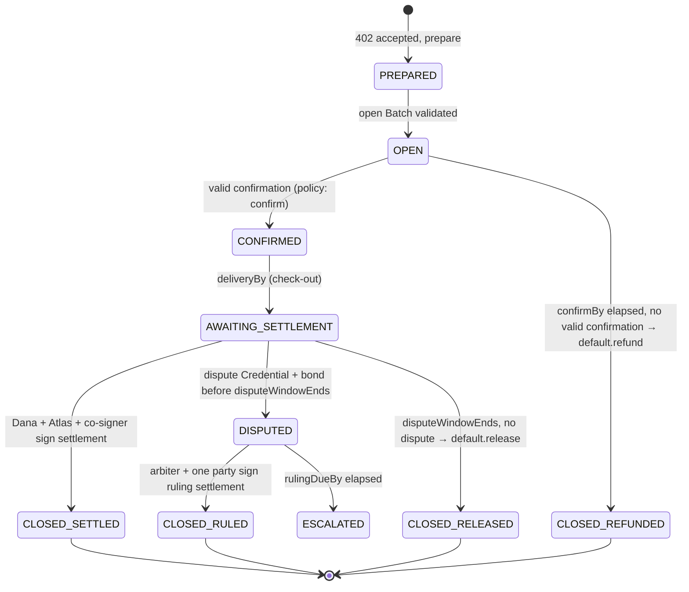
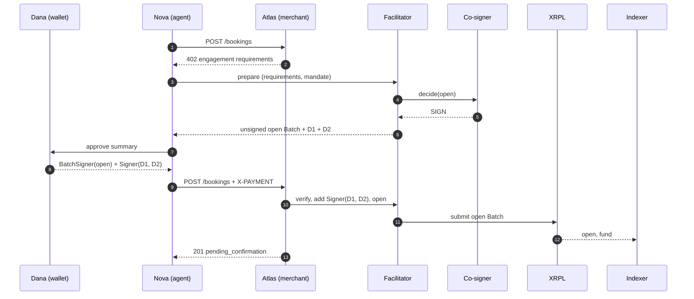

# Use case: Dana's agent books a hotel

> A worked specification for the full design. One deal is followed end to end, with concrete artifacts at every step: template, mandate, policy, x402 messages, XRPL transactions, ledger state and indexer records.
> Status: **design draft** (October 2026). Stage 0 primitives only (multisig, Tickets, Credentials, Batch), all live on mainnet. Addresses, hashes and signatures are placeholders.

---

## 0. The deal in one paragraph

Dana asks her agent **Nova** to book 3 nights in Lisbon for at most 450 RLUSD. Nova finds an offer from **Atlas Stays**, an agentic travel merchant, for 412.00 RLUSD. Atlas accepts payment through an **engagement**. The money moves into a fresh XRPL account that only Dana, Atlas, an arbiter (**Fairwind Arbitration**) and the service's policy co-signer can control together. The account is deleted when the deal ends. There are four ways the deal can end:

| Path | What happens | Who signs the outcome | Ends with |
|---|---|---|---|
| **A. Happy** | Booking confirmed, stay happens, Dana leaves a review | Dana + Atlas + co-signer | Atlas paid, service fee paid, account deleted |
| **B. Mismatch at confirmation** | Atlas confirms the wrong city and doesn't fix it in time | Pre-signed refund default, completed by the co-signer | Dana refunded in full, account deleted |
| **C. Dispute** | Dana is downgraded to a worse room and disputes | Arbiter + Dana | 30% back to Dana, rest to Atlas, account deleted |
| **D. Silence** | Stay happens, nobody acts | Pre-signed release default, completed by the co-signer | Atlas paid ("no review"), account deleted |

All names are fictional.

---

## 1. Cast and accounts

| Party | Role | XRPL account | Holds key in | Weight |
|---|---|---|---|---|
| Dana | Principal | `rDana…` | Wallet (e.g. Xaman) | 2 |
| Nova | Dana's agent. **Not a signer.** Prepares everything, Dana signs | none needed | n/a | n/a |
| Atlas Stays | Counterparty (merchant) | `rAtlas…` | Merchant backend (HSM) | 2 |
| Fairwind Arbitration | Arbiter | `rFairwind…` | Arbiter service | 3 |
| Engagement service: co-signer | Policy co-signer | `rCoSign…` | Co-signer service | 1 |
| Engagement service: operator | Pre-creates accounts, funds reserves, receives fee and reserves back | `rService…` | Service treasury | n/a |
| Engagement account | Holds the deal's funds | `rEngage7Q…` | Master key disabled at pre-create; service RegularKey removed at open | n/a |
| RLUSD issuer | Asset issuer | `rRLUSD…` | n/a | n/a |

**Quorum: 5.** Why these weights:

| Signer set | Weight | Reaches quorum? | Meaning |
|---|---|---|---|
| Dana + Atlas + co-signer | 5 | ✅ | Happy path. Policy is **enforced**, because the co-signer is required whenever only the two parties agree. |
| Fairwind + Dana | 5 | ✅ | Ruling in Dana's favour, with no service involved. |
| Fairwind + Atlas | 5 | ✅ | Ruling in Atlas's favour, with no service involved. |
| Dana + Atlas | 4 | ❌ | The parties can't bypass policy alone… |
| Dana + Atlas + Fairwind | 7 | ✅ | …except together with the arbiter (service unavailable). |
| Co-signer + any one other | ≤ 4 | ❌ | The service can't move funds with any single party. |
| Fairwind alone | 3 | ❌ | The arbiter can't move funds alone. |

**Trust assumption, stated plainly:** Fairwind + Atlas *can* pay Atlas without Dana. That's what an arbiter is. It's mitigated by arbiter accountability (§9) and by the arbiter being named in the terms Dana signs.

---

## 2. The template

A **template** is a reusable deal shape. An **engagement** is a template bound to parties, amounts and dates.

```json
{
  "templateId": "settlement-vault/hotel@1",
  "description": "Prepaid booking with confirmation deadline, dispute window and arbiter",
  "asset": { "type": "IOU", "currency": "RLUSD", "issuerRef": "asset.issuer" },
  "roles": {
    "principal":    { "weight": 2, "operatedBy": "external" },
    "counterparty": { "weight": 2, "operatedBy": "external" },
    "arbiter":      { "weight": 3, "operatedBy": "external", "allowlistRef": "arbiters.hotel" },
    "cosigner":     { "weight": 1, "operatedBy": "service" }
  },
  "quorum": 5,
  "requiredCredentials": {
    "counterparty": [{ "issuerRef": "kyb.providers", "type": "KYB_VERIFIED" }],
    "arbiter":      [{ "issuerRef": "service.root",  "type": "ARBITER_ACCREDITED" }]
  },
  "timers": {
    "confirmBy":         { "from": "open",       "durationSecs": 7200 },
    "disputeWindowEnds": { "from": "deliveryBy", "durationSecs": 259200 },
    "rulingDueBy":       { "from": "disputeOpened", "durationSecs": 432000 }
  },
  "outcomes": {
    "settle.agreed":   { "signers": [["principal","counterparty","cosigner"]], "blueprint": "close.split",   "policyStage": "settle" },
    "settle.ruling":   { "signers": [["arbiter","principal"],["arbiter","counterparty"]], "blueprint": "close.split", "policyStage": null, "requires": "ruling" },
    "default.refund":  { "presigned": true, "signers": [["principal","counterparty","cosigner"]], "blueprint": "close.refundAll",  "finalSigner": "cosigner", "policyStage": "default.refund" },
    "default.release": { "presigned": true, "signers": [["principal","counterparty","cosigner"]], "blueprint": "close.releaseAll", "finalSigner": "cosigner", "policyStage": "default.release" }
  },
  "fees": { "serviceFeeBps": 50, "paidBy": "counterparty" },
  "dispute": { "mechanism": "credential+bond", "credentialType": "ENG/DISPUTE", "minBond": "10" },
  "ticketPlan": {
    "default.release": { "outer": 1, "inner": ["pay.counterparty","pay.serviceFee","trustline.remove","account.delete"] },
    "default.refund":  { "outer": 1, "inner": ["pay.principal","trustline.remove","account.delete"] }
  },
  "policyRef": "pol_hotel@1.0.0"
}
```

### Template validation

**Templates must be validated.** The non-custodial claim depends on their weights. The validator computes every *minimal* signer set that reaches quorum and checks hard invariants. It runs at template publish time and again at every open.

**Minimal winning sets** for this template: `{arbiter, principal}`, `{arbiter, counterparty}`, `{principal, counterparty, cosigner}`.

| # | Invariant | Result |
|---|---|---|
| V1 | Service-operated weight (1) < quorum (5), and no minimal set ⊆ service-operated roles | ✅ |
| V2 | No single role reaches quorum | ✅ (max single weight 3) |
| V3 | **Liveness without the service:** at least one minimal set excludes all service roles | ✅ `{arbiter, principal}`, `{arbiter, counterparty}` |
| V4 | Every outcome's signer sets are winning sets | ✅ |
| V5 | Every pre-signed default has a `finalSigner` that's service-operated or the arbiter, and the other signers reach quorum − finalSigner weight | ✅ (2 + 2 = 4 = 5 − 1) |
| V6 | Every timer has a default outcome, or is explicitly arbiter-resolved | ✅ confirmBy → refund, disputeWindowEnds → release, rulingDueBy → escalation (§9) |
| V7 | Every Batch blueprint has ≤ 8 inner transactions and ends with `AccountDelete` | ✅ (max 4) |
| V8 | Ticket plan covers outer + every inner transaction of every pre-signed outcome | ✅ 9 Tickets |
| V9 | Reserve budget fits the pre-create funding (§4) | ✅ |
| V10 | Principal protection: list every winning set that excludes the principal. Each must be declared as a trust assumption | ⚠️ `{arbiter, counterparty}`, declared |

A template that fails V1–V9 can't be published. V10 produces a disclosure that's shown to the principal at signing.

---

## 3. Documents (off-ledger, hashed on-ledger)

All documents are canonical JSON (RFC 8785), signed by the author's XRPL key. Only their hashes go on the ledger. They use the common statement envelope defined in [`spec/attestations.md`](../spec/attestations.md) (types `party.mandate/1`, `party.confirmation/1`, `party.review/1`, `party.ruling/1`). The bodies below show only the type-specific content.

**Mandate** (signed by Dana, before Nova shops):

```json
{
  "type": "eng.mandate/1",
  "mandateId": "mnd_8K2…",
  "principal": "rDana…",
  "agent": { "name": "Nova", "kya": "kya:…" },
  "purpose": "lodging",
  "constraints": {
    "city": "Lisbon", "country": "PT",
    "checkIn": "2026-11-11", "checkOut": "2026-11-14",
    "guests": 2, "minRoomClass": "double-superior",
    "maxTotal": { "currency": "RLUSD", "value": "450.00" },
    "freeCancellationUntilHoursBefore": 48
  },
  "allowedTemplates": ["settlement-vault/hotel@1"],
  "allowedArbiters": ["rFairwind…"],
  "expires": "2026-10-21T00:00:00Z",
  "signature": "…"
}
```

**Booking confirmation** (signed by Atlas):

```json
{
  "type": "eng.confirmation/1",
  "engagementId": "eng_01J9…",
  "mandateHash": "att:3b1f…",
  "bookingId": "ATL-55821",
  "property": "Casa Alfama", "city": "Lisbon", "country": "PT",
  "checkIn": "2026-11-11", "checkOut": "2026-11-14",
  "roomClass": "double-superior", "guests": 2,
  "total": { "currency": "RLUSD", "value": "412.00" },
  "cancellation": "free until 2026-11-09T14:00:00Z",
  "signature": "…"
}
```

**Review** (signed by Dana, path A):

```json
{ "type": "eng.review/1", "engagementId": "eng_01J9…", "bookingId": "ATL-55821",
  "stayed": true, "rating": 5, "text": "…", "signature": "…" }
```

**Ruling** (signed by Fairwind, path C), §9.

---

## 4. Engagement record and state machine

The **engagement record** is the object every component reads: facilitator, co-signer, arbiter, indexer.

```json
{
  "engagementId": "eng_01J9…",
  "template": "settlement-vault/hotel@1",
  "policy": { "id": "pol_hotel@1.0.0", "hash": "sha256:a77c…" },
  "account": "rEngage7Q…",
  "parties": {
    "principal": "rDana…", "counterparty": "rAtlas…",
    "arbiter": "rFairwind…", "cosigner": "rCoSign…"
  },
  "amount": { "currency": "RLUSD", "issuer": "rRLUSD…", "value": "412.00" },
  "fee": { "bps": 50, "value": "2.06", "to": "rService…" },
  "timers": {
    "openedAt": "2026-10-20T09:00:00Z",
    "confirmBy": "2026-10-20T11:00:00Z",
    "deliveryBy": "2026-11-14T11:00:00Z",
    "disputeWindowEnds": "2026-11-17T11:00:00Z"
  },
  "hashes": { "mandate": "att:3b1f…", "confirmation": null, "review": null, "ruling": null },
  "tickets": { "default.release": [101,102,103,104,105], "default.refund": [106,107,108,109] },
  "presigned": { "default.release": "blob…(Dana+Atlas)", "default.refund": "blob…(Dana+Atlas)" },
  "state": "OPEN"
}
```



`CONFIRMED` may also go straight to `CLOSED_SETTLED` before check-out if both parties agree (e.g. an early settlement).

---

## 5. The policy and how the co-signer evaluates it

### 5.1 Policy document

> The executable version is [`policies/hotel@1.1.0.json`](../../policies/hotel@1.1.0.json), and it is checked by the conformance vectors in [`vectors/`](../../vectors/README.md). Where the illustrative syntax below differs (named arguments, `att.all`), the shipped file and [policy spec §15](../spec/policy.md#15-reference-implementation) are authoritative.

Declarative rules in the (proposed) MPCP policy format. No code. Expressions are CEL-style over a fixed input model.

```json
{
  "policyId": "pol_hotel", "version": "1.0.0",
  "appliesTo": ["settlement-vault/hotel@1"],
  "params": { "serviceFeeBps": 50, "minDisputeBond": "10.00" },
  "stages": {
    "open": [
      { "id": "O1", "check": "mandate.signature.valid && mandate.principal == eng.parties.principal", "reason": "BAD_MANDATE" },
      { "id": "O2", "check": "now < mandate.expires", "reason": "MANDATE_EXPIRED" },
      { "id": "O3", "check": "offer.total <= mandate.constraints.maxTotal", "reason": "OVER_BUDGET" },
      { "id": "O4", "check": "eng.template in mandate.allowedTemplates && eng.parties.arbiter in mandate.allowedArbiters", "reason": "TERMS_NOT_AUTHORIZED" },
      { "id": "O5", "check": "ledger.hasCredential(eng.parties.counterparty, 'KYB_VERIFIED')", "reason": "COUNTERPARTY_UNVERIFIED" },
      { "id": "O6", "check": "tx.open.matchesBlueprint(eng) && tx.defaults.matchBlueprints(eng)", "reason": "TX_MISMATCH" }
    ],
    "confirm": [
      { "id": "C1", "check": "confirmation.signer == eng.parties.counterparty && confirmation.mandateHash == eng.hashes.mandate", "reason": "BAD_CONFIRMATION" },
      { "id": "C2", "check": "confirmation.city == mandate.constraints.city && confirmation.checkIn == mandate.constraints.checkIn && confirmation.checkOut == mandate.constraints.checkOut", "reason": "MANDATE_MISMATCH" },
      { "id": "C3", "check": "roomClass.rank(confirmation.roomClass) >= roomClass.rank(mandate.constraints.minRoomClass)", "reason": "ROOM_BELOW_MANDATE" },
      { "id": "C4", "check": "confirmation.total == eng.amount", "reason": "AMOUNT_MISMATCH" }
    ],
    "settle": [
      { "id": "S1", "check": "eng.state in ['CONFIRMED','AWAITING_SETTLEMENT'] && !ledger.disputeOpen(eng)", "reason": "WRONG_STATE" },
      { "id": "S2", "check": "tx.matchesBlueprint('close.split') && tx.payouts.sum() == ledger.balance(eng.account, eng.amount.asset)", "reason": "PAYOUT_MISMATCH" },
      { "id": "S3", "check": "tx.payouts.destinations() subsetOf [eng.parties.principal, eng.parties.counterparty, eng.fee.to]", "reason": "UNAUTHORIZED_DESTINATION" },
      { "id": "S4", "check": "tx.payouts.to(eng.fee.to) == fee(tx.payouts.to(eng.parties.counterparty) + tx.payouts.to(eng.fee.to))", "reason": "FEE_MISMATCH" },
      { "id": "S5", "check": "tx.memo('eng/review') != null && review.signer == eng.parties.principal", "reason": "REVIEW_REQUIRED" }
    ],
    "default.refund": [
      { "id": "R1", "check": "now >= eng.timers.confirmBy && eng.state == 'OPEN'", "reason": "NOT_DUE" },
      { "id": "R2", "check": "ledger.balance(eng.account, eng.amount.asset) == eng.amount", "reason": "BALANCE_CHANGED" }
    ],
    "default.release": [
      { "id": "L1", "check": "now >= eng.timers.disputeWindowEnds && eng.state == 'AWAITING_SETTLEMENT'", "reason": "NOT_DUE" },
      { "id": "L2", "check": "!ledger.disputeOpen(eng)", "reason": "DISPUTE_OPEN" },
      { "id": "L3", "check": "ledger.balance(eng.account, eng.amount.asset) == eng.amount", "reason": "BALANCE_CHANGED" }
    ]
  }
}
```

Note S5: the review must be **present** and signed by Dana. Its **content** (rating, text) is never an input to any rule.

### 5.2 Evaluation model

The co-signer is a **pure function** plus a signing key:

```
decide(stage, proposedTx, engagementRecord, ledgerView@index, attestations) → {
  decision: SIGN | REFUSE,
  reasons: ["S2:PAYOUT_MISMATCH", …],
  policyHash, inputsHash, ledgerIndex
}
```

- **Deterministic.** Ledger reads are pinned to a validated ledger index. External signals (KYA scores, Verifiable Intent, risk scores) enter only as **signed attestations** in `attestations`, never as live calls during evaluation.
- **Logged.** Every decision is appended to the decision log, `{decision, reasons, policyHash, inputsHash, ledgerIndex, txHash}`, and its hash is shipped to the indexer. Anyone holding the inputs can re-run a decision.
- **Fail-closed.** Unknown stage, unparsable input or any failed rule → `REFUSE`.

### 5.3 When the co-signer runs

| Stage | Trigger | What it gates | Enforced how |
|---|---|---|---|
| `open` | Facilitator `prepare` | Whether the service builds and submits the open Batch | Service-side (before the account is under quorum) |
| `confirm` | Merchant posts confirmation | `OPEN → CONFIRMED`. Whether `default.refund` stays armed | Service state + withheld signature on the refund default |
| `settle` | Parties submit a settlement | Co-signer signature on `settle.agreed` | **Ledger**: Dana + Atlas = 4 < 5 without it |
| `default.refund` | Timer `confirmBy` | Co-signer adds its final signature to the refund blob | **Ledger**: the blob is 1 weight short without it |
| `default.release` | Timer `disputeWindowEnds` | Co-signer adds its final signature to the release blob | **Ledger**: same |
| (ruling) | n/a | Not gated. Arbiter + one party reach quorum without the co-signer | Arbiter accountability (§9) |

---

## 6. x402 integration

> **Note:** this flow uses the proposed `engagement` scheme and its own facilitator. That's not optional: the reference XRPL `exact` facilitator rejects multisigned blobs and memos, so it could not carry the settlement transactions below anyway. Engagement accounts that pay simpler x402 merchants today do so through the settlement adapter's `prepaid` scheme — see the [x402 research](../research/x402-multisig.md) and the [x402 purchase walkthrough](../demo/x402-purchase.md).

### 6.1 Messages

**① Nova requests a booking:**

```
POST /bookings   { "offerId": "off_casa-alfama_3n", "guests": 2 }
```

**② Atlas responds 402** with an `engagement` payment requirement:

```json
{
  "x402Version": 2,
  "accepts": [{
    "scheme": "engagement",
    "network": "xrpl:mainnet",
    "asset": { "currency": "RLUSD", "issuer": "rRLUSD…" },
    "maxAmountRequired": "412.00",
    "payTo": "rAtlas…",
    "resource": "https://api.atlas.example/bookings",
    "extra": {
      "facilitator": "https://engage.example",
      "template": "settlement-vault/hotel@1",
      "arbiter": "rFairwind…",
      "confirmWithinSecs": 7200,
      "deliveryBy": "2026-11-14T11:00:00Z",
      "disputeWindowSecs": 259200,
      "serviceFeeBps": 50,
      "mandateRequired": true,
      "reviewRequired": true
    }
  }]
}
```

**③ Nova prepares the engagement** with the facilitator. The open-stage policy runs here.

```
POST https://engage.example/v1/engagements/prepare
{ "requirements": <the accepts[0] above>, "mandate": <signed mandate>, "principal": "rDana…" }

→ 200
{
  "engagementId": "eng_01J9…",
  "account": "rEngage7Q…",
  "disclosures": ["Fairwind + Atlas can settle without you (arbiter ruling)."],
  "toSign": {
    "openBatch":      { "role": "BatchSigner", "tx": <unsigned open Batch, §7.2> },
    "defaultRelease": { "role": "Signer",      "tx": <unsigned D1, §7.4> },
    "defaultRefund":  { "role": "Signer",      "tx": <unsigned D2, §7.4> }
  },
  "policyDecision": { "stage": "open", "decision": "SIGN", "policyHash": "sha256:a77c…" }
}
```

**④ Dana signs** three items in her wallet, presented by Nova as one approval with a human-readable summary: her `BatchSigner` signature over the open Batch (which carries her 412 RLUSD funding payment), and her multisig `Signer` entries on D1 and D2.

**⑤ Nova retries the request** with the payment header:

```
POST /bookings
X-PAYMENT: base64({
  "x402Version": 2, "scheme": "engagement", "network": "xrpl:mainnet",
  "payload": {
    "engagementId": "eng_01J9…",
    "openBatchSigner": { "Account": "rDana…", "SigningPubKey": "…", "TxnSignature": "…" },
    "defaultSignatures": { "defaultRelease": { "Signer": … }, "defaultRefund": { "Signer": … } },
    "mandate": <signed mandate>
  }
})
```

**⑥ Atlas verifies and opens.** Atlas calls `POST /v1/engagements/{id}/verify`, then adds its own `Signer` entries to D1 and D2 (its commitment to the refund-if-unconfirmed and release-after-window terms), then calls `POST /v1/engagements/{id}/open`. The facilitator signs the open Batch with the account's master key, submits, and waits for validation.

**⑦ Atlas responds:**

```
201 Created
X-PAYMENT-RESPONSE: base64({ "engagementId": "eng_01J9…", "account": "rEngage7Q…", "openTx": "E3A9…", "status": "OPEN" })
{ "bookingId": "ATL-55821", "status": "pending_confirmation" }
```

### 6.2 Facilitator API (v0 surface)

| Endpoint | Caller | Purpose |
|---|---|---|
| `POST /v1/engagements/prepare` | Client agent | Run open-stage policy. Allocate a pre-created account. Return the unsigned open Batch + defaults |
| `POST /v1/engagements/{id}/verify` | Merchant | Check client signatures, mandate, policy decision |
| `POST /v1/engagements/{id}/open` | Merchant | Add merchant default signatures, submit the open Batch |
| `POST /v1/engagements/{id}/confirm` | Merchant | Submit the signed confirmation. Runs confirm-stage policy |
| `POST /v1/engagements/{id}/settle` | Either party | Collect signatures on a settlement. Co-signer evaluates `settle`. Submit at quorum |
| `POST /v1/engagements/{id}/dispute` | Principal | Register an evidence bundle after the dispute Credential + bond land on-ledger |
| `GET  /v1/engagements/{id}` | Anyone authorized | Engagement record + state |

The facilitator coordinates. It never holds enough weight to settle: its only key on an open account is the co-signer's (weight 1).

---

## 7. XRPL transactions

Notation: `tfAllOrNothing` = `0x00010000`, `tfInnerBatchTxn` = `0x40000000`. Inner transactions carry `Fee: "0"`, an empty `SigningPubKey`, and no signature. The outer transaction pays all fees. RLUSD's currency code is hex `524C555344000000000000000000000000000000`, written `RLUSD` below. Memos are shown as plain text but are hex-encoded on-ledger. RLUSD's transfer fee is assumed to be 0. If it isn't, payouts need `SendMax`.

### 7.1 Pre-create (before any deal)

The service creates `rEngage7Q…` with ~4 XRP, adds the RLUSD trust line (`TrustSet`, `tfSetNoRipple`), installs its own key as the account's **`RegularKey`** (`SetRegularKey`), and **disables the master key** (`AccountSet` + `asfDisableMaster`). Both are normal transactions signed with the master key, which is then discarded. It then waits more than 256 ledgers, so `AccountDelete` will be allowed at close.

> **Why at pre-create (spike finding F1):** `asfDisableMaster` requires a transaction signed with the master key (`tecNEED_MASTER_KEY` otherwise), and inner Batch transactions are unsigned. So the master key can't be disabled inside the open Batch. The first testnet run failed exactly there, and `ALLORNOTHING` rolled back the whole open. Reserve budget at current settings (base 1 XRP, 0.2 XRP per object):

| Item | Reserve |
|---|---|
| Account base | 1.0 |
| RLUSD trust line | 0.2 |
| SignerList (one object regardless of entries) | 0.2 |
| 9 Tickets | 1.8 |
| **Total reserved** | **3.2 XRP** |
| Fee headroom (AccountDelete fee 0.2 + Batch fees) | ~0.8 XRP |

Everything except the burned fees (~0.21 XRP) returns to `rService…` at close.

### 7.2 Open Batch

Signed on the outer transaction by the **service's key, installed as the account's `RegularKey`** at pre-create, plus Dana as `BatchSigner` for her funding payment. `N` is the account's current sequence.

```json
{
  "TransactionType": "Batch",
  "Account": "rEngage7Q…",
  "Flags": 65536,
  "Sequence": N,
  "Fee": "<batch fee>",
  "Memos": [{ "Memo": { "MemoType": "eng/open", "MemoData": "eng_01J9…|mandate=att:3b1f…|policy=sha256:a77c…|template=settlement-vault/hotel@1" } }],
  "RawTransactions": [
    { "RawTransaction": {
        "TransactionType": "Payment", "Account": "rDana…", "Destination": "rEngage7Q…",
        "Amount": { "currency": "RLUSD", "issuer": "rRLUSD…", "value": "412.00" },
        "Flags": 1073741824, "Sequence": "<Dana seq>", "Fee": "0", "SigningPubKey": "" } },
    { "RawTransaction": {
        "TransactionType": "SignerListSet", "Account": "rEngage7Q…", "SignerQuorum": 5,
        "SignerEntries": [
          { "SignerEntry": { "Account": "rDana…",     "SignerWeight": 2 } },
          { "SignerEntry": { "Account": "rAtlas…",    "SignerWeight": 2 } },
          { "SignerEntry": { "Account": "rFairwind…", "SignerWeight": 3 } },
          { "SignerEntry": { "Account": "rCoSign…",   "SignerWeight": 1 } } ],
        "Flags": 1073741824, "Sequence": N+1, "Fee": "0", "SigningPubKey": "" } },
    { "RawTransaction": {
        "TransactionType": "TicketCreate", "Account": "rEngage7Q…", "TicketCount": 9,
        "Flags": 1073741824, "Sequence": N+2, "Fee": "0", "SigningPubKey": "" } },
    { "RawTransaction": {
        "TransactionType": "SetRegularKey", "Account": "rEngage7Q…",
        "Flags": 1073741824, "Sequence": N+12, "Fee": "0", "SigningPubKey": "" } }
  ],
  "BatchSigners": [{ "BatchSigner": { "Account": "rDana…", "SigningPubKey": "…", "TxnSignature": "…" } }],
  "SigningPubKey": "<service pubkey (the account's RegularKey)>",
  "TxnSignature": "…"
}
```

- `TicketCreate` at sequence `N+2` with count 9 creates Tickets `N+3 … N+11` (written 101–109 in this document). The next sequence is `N+12`. Ticket numbers are therefore known **before** submission, which is what lets D1 and D2 be pre-signed in step ④.
- `SetRegularKey` **without** a `RegularKey` field removes the service's key. It's valid because the SignerList was created by an earlier inner transaction (otherwise `tecNO_ALTERNATIVE_KEY`), and unlike `asfDisableMaster` it needs no master-key signature. After validation **only the SignerList** can authorize anything on the account.
- `ALLORNOTHING`: if Dana's payment fails (e.g. insufficient RLUSD), nothing happens. The account stays a clean pre-created account and goes back to the buffer.

**Ledger state after open:**

| Object | Content |
|---|---|
| AccountRoot `rEngage7Q…` | `lsfDisableMaster`, **no `RegularKey`**, XRP ≈ 4, Sequence N+13 |
| SignerList | Dana 2, Atlas 2, Fairwind 3, CoSign 1 · quorum 5 |
| RippleState | 412.00 RLUSD |
| Ticket × 9 | 101–109 |

### 7.3 Settlement Batch: path A (`settle.agreed`)

Built at settlement time with live sequence numbers and a `LastLedgerSequence`. Multisigned on the outer transaction by Dana, Atlas and the co-signer.

```json
{
  "TransactionType": "Batch", "Account": "rEngage7Q…", "Flags": 65536,
  "Sequence": M, "LastLedgerSequence": "<current + 20>", "Fee": "<batch fee + AccountDelete fee + multisig>",
  "Memos": [{ "Memo": { "MemoType": "eng/settle", "MemoData": "eng_01J9…|outcome=settle.agreed|review=att:c41e…|confirmation=att:77d0…" } }],
  "RawTransactions": [
    { "RawTransaction": { "TransactionType": "Payment", "Account": "rEngage7Q…", "Destination": "rAtlas…",
        "Amount": { "currency": "RLUSD", "issuer": "rRLUSD…", "value": "409.94" }, "Flags": 1073741824, "Sequence": M+1, "Fee": "0", "SigningPubKey": "" } },
    { "RawTransaction": { "TransactionType": "Payment", "Account": "rEngage7Q…", "Destination": "rService…",
        "Amount": { "currency": "RLUSD", "issuer": "rRLUSD…", "value": "2.06" }, "Flags": 1073741824, "Sequence": M+2, "Fee": "0", "SigningPubKey": "" } },
    { "RawTransaction": { "TransactionType": "TrustSet", "Account": "rEngage7Q…",
        "LimitAmount": { "currency": "RLUSD", "issuer": "rRLUSD…", "value": "0" }, "Flags": 1073872896, "Sequence": M+3, "Fee": "0", "SigningPubKey": "" } },
    { "RawTransaction": { "TransactionType": "AccountDelete", "Account": "rEngage7Q…", "Destination": "rService…",
        "Flags": 1073741824, "Sequence": M+4, "Fee": "0", "SigningPubKey": "" } }
  ],
  "SigningPubKey": "",
  "Signers": [
    { "Signer": { "Account": "rAtlas…",   "SigningPubKey": "…", "TxnSignature": "…" } },
    { "Signer": { "Account": "rCoSign…",  "SigningPubKey": "…", "TxnSignature": "…" } },
    { "Signer": { "Account": "rDana…",    "SigningPubKey": "…", "TxnSignature": "…" } }
  ]
}
```

- TrustSet flags = `tfInnerBatchTxn | tfSetNoRipple`, which returns the line to default state so it's deleted.
- Payouts must sum to the **exact** RLUSD balance (409.94 + 2.06 = 412.00), or the trust-line removal fails and the whole Batch fails.
- `AccountDelete` (last) removes the SignerList and the 9 unused Tickets, killing D1 and D2, and sends the remaining XRP to `rService…`.

### 7.4 Pre-signed defaults (D1 release, D2 refund)

Same shape as §7.3, but **every** transaction uses a Ticket (`Sequence: 0`, `TicketSequence: t`) and there's **no** `LastLedgerSequence`, so the blobs stay valid until their Tickets are consumed or the account is deleted.

| | Outer | Inner 1 | Inner 2 | Inner 3 | Inner 4 |
|---|---|---|---|---|---|
| **D1 `default.release`** | Batch · T101 | Pay Atlas 409.94 · T102 | Pay service 2.06 · T103 | TrustSet remove · T104 | AccountDelete → rService · T105 |
| **D2 `default.refund`** | Batch · T106 | Pay Dana 412.00 · T107 | TrustSet remove · T108 | AccountDelete → rService · T109 | n/a |

- Signed at open by **Dana (2) + Atlas (2) = 4**. That's one short of quorum, so neither blob is submittable as stored. The co-signer adds the **final** signature only when its policy stage passes (§5.3). A leaked blob is useless without it.
- **Fee risk:** the outer `Fee` is fixed at pre-sign time, so it carries headroom (e.g. 3× expected). If network fees escalate beyond that, the default must be re-signed, which is an operational risk to monitor.
- **Exact-balance property:** D1 pays out exactly 412.00. If **any** extra RLUSD lands in the account (e.g. a dispute bond, §8.C), the trust line keeps a balance, `AccountDelete` fails (`tecHAS_OBLIGATIONS`) and `ALLORNOTHING` rolls back every payout, so **D1 becomes unexecutable on-ledger**. The dispute bond therefore doubles as a ledger-enforced lock on the release default.
- **Defaults are single-shot (finding F2):** a failed `ALLORNOTHING` Batch is still applied as a transaction and **consumes its outer Ticket** (rippled `Batch_test`, "all or nothing"). One failed submission of D1 kills D1 for good. So the co-signer must check the exact ledger state at its pinned ledger before adding the final signature (policy rule L3 / R2). If a default is burned (e.g. dust lands between signature and validation), the outcome falls back to a fresh agreement (P + C + S) or a ruling (A + one party).

---

## 8. The four paths



### A. Happy path

1. **Confirm (T+10 min).** Atlas posts its signed confirmation to `/confirm` and anchors the hash on-ledger with a no-op `AccountSet` from `rAtlas…`, memo `eng/confirm|eng_01J9…|att:77d0…`. Nova and the co-signer both run the `confirm` rules C1–C4: pass. State `CONFIRMED`. The co-signer will now refuse to complete D2.
2. **Stay (Nov 11–14).** At `deliveryBy` (check-out), state `AWAITING_SETTLEMENT`.
3. **Review + settle (Nov 14).** Nova drafts the review and the §7.3 Batch. Dana approves both in her wallet (one review signature, one multisig signature). Atlas signs via `/settle`. The co-signer runs S1–S5: the state is right, payouts sum to the balance, destinations are authorized, the fee is correct, a review signed by Dana is present. It signs. Quorum is 5, and the facilitator submits.
4. **Result.** Atlas +409.94, service +2.06 RLUSD, account deleted, ~3.99 XRP back to the service, D1/D2 dead.

### B. Mismatch at confirmation

1. Atlas's confirmation says **Porto**. C2 fails with `MANDATE_MISMATCH`. Nova tells Dana within seconds, and the facilitator returns the reason to Atlas.
2. Atlas has until `confirmBy` (2 h) to post a corrected confirmation. It doesn't.
3. At `confirmBy` the co-signer runs R1–R2 (due, state `OPEN`, balance unchanged): pass. It adds its signature to **D2**, and the facilitator submits.
4. **Result.** Dana +412.00 RLUSD, account deleted, no arbiter involved. This is the "wrong city" case from the design discussion, handled automatically.

### C. Dispute: downgraded room

1. **Nov 12.** Dana is moved to a standard room. On Nov 15, inside the window, Nova submits a single-account Batch from `rDana…` (`ALLORNOTHING`):
   - `CredentialCreate`: `Subject: rEngage7Q…`, `CredentialType: hex("ENG/DISPUTE")`, `URI: hex(evidence bundle hash)`;
   - `Payment` 10.00 RLUSD → `rEngage7Q…`, memo `eng/dispute-bond`.

   Then it registers the evidence bundle via `/dispute`.
2. **Effects.** The co-signer sees the Credential (`ledger.disputeOpen` = true), so L2 fails and it will never complete D1. Independently, the account now holds 422.00, so **D1 can't execute on-ledger anyway** (§7.4). State `DISPUTED`.
3. **Evidence (5 days).** Atlas responds through the arbiter's evidence API (§9). Fairwind reviews the confirmation (double-superior), Dana's photos, and Atlas's admission of overbooking.
4. **Ruling (Nov 18).** Fairwind signs a ruling: 30% of the booking back to Dana, bond returned because the dispute was upheld.

   | Payout | Amount (RLUSD) |
   |---|---|
   | Dana: 30% of 412.00 + bond 10.00 | 133.60 |
   | Atlas: 288.40 − 0.5% fee | 286.96 |
   | Service fee: 0.5% of 288.40 | 1.44 |
   | **Total = account balance** | **422.00** |

5. **Execution.** Fairwind (3) + Dana (2) multisign a `close.split` Batch with these three payouts + TrustSet + AccountDelete. Memo `eng/settle|outcome=settle.ruling|ruling=att:e9a2…`. The co-signer isn't needed. Submitted.
6. **Cleanup.** None needed. `AccountDelete` removes Dana's dispute Credential with the account and releases her reserve (verified on testnet, spike finding F3).

### D. Silence

1. Confirmed, stayed, but Dana never reviews and nobody settles.
2. At `disputeWindowEnds` (Nov 17, 11:00) the co-signer runs L1–L3: due, no dispute, balance unchanged. It adds its signature to **D1** and the facilitator submits.
3. **Result.** Atlas +409.94, service +2.06, account deleted. The indexer records `outcome=default.release`, `review=none`.

---

## 9. Arbiter

What this use case needs from an arbiter:

| Need | v0 answer |
|---|---|
| **Identity & accreditation** | `ARBITER_ACCREDITED` Credential issued by the service root. Listed in the template's arbiter allowlist. Named in the 402 and the mandate's `allowedArbiters` |
| **Terms** | Published once per arbiter: scope (lodging disputes ≤ 5,000 RLUSD), fee (v0: paid by the service from its fee), SLA (`rulingDueBy` = 5 days), conflict-of-interest policy |
| **Appointment** | Implicit: being on the SignerList *is* the appointment. v0 has no per-engagement acceptance step |
| **Dispute trigger** | On-ledger dispute Credential + bond (§8.C). The arbiter's watcher picks it up |
| **Evidence protocol** | Evidence API with a 72 h submission window per side. Each item is hashed. The bundle hash goes in the dispute Credential's `URI` (principal) or a memo (merchant). Inputs: mandate, confirmation, both sides' evidence, decision log |
| **Ruling format** | Signed JSON: `{type: "eng.ruling/1", engagementId, outcome, payouts[], bondTo, reasons, evidenceHashes, settlementTxHash}`. `settlementTxHash` binds the ruling to the exact Batch the arbiter signs |
| **Execution** | Arbiter + the party who accepts the ruling multisign. No service signature needed |
| **Escalation** | `rulingDueBy` elapsed → the service reassigns the case to a backup arbiter. v0 can't swap signers, since a SignerList change needs quorum. So v0 escalation is "Fairwind's panel takes over under Fairwind's key". A real backup arbiter needs a second arbiter slot in the template (open question) |
| **Accountability** | All rulings are on-ledger (memo + signer). The indexer derives ruling history and outcome distribution, and ruling-vs-evidence audits are possible |
| **Deterministic fast track** | Mismatches against the mandate (city, dates, amount) never reach the arbiter. They're caught by `confirm` rules and refunded by D2 |

---

## 10. Indexer

**Sources:** `xrpl-monitor` subscribed to engagement accounts, party accounts (for confirmation anchors and dispute Credentials) and the service accounts. The facilitator pushes off-ledger documents, each checked against its on-ledger hash.

**Events recorded for this deal (path A):**

| # | Event | Source | Key fields |
|---|---|---|---|
| 1 | `engagement.opened` | open Batch tx | account, template, mandate hash, policy hash, amount, parties |
| 2 | `engagement.confirmed` | Atlas `AccountSet` memo + `/confirm` | confirmation hash, latency (10 min) |
| 3 | `cosigner.decision` × n | decision log | stage, decision, reasons, inputsHash |
| 4 | `engagement.settled` | settlement Batch tx | outcome, payouts, review hash, fee |
| 5 | `engagement.closed` | AccountDelete in same Batch | reserve returned, burned XRP |

**Derived engagement record** (immutable once closed):

```json
{
  "engagementId": "eng_01J9…", "account": "rEngage7Q…", "template": "settlement-vault/hotel@1",
  "counterparty": "rAtlas…", "principal": "rDana…", "arbiter": "rFairwind…",
  "amount": "412.00 RLUSD", "outcome": "settle.agreed",
  "paidToCounterparty": "409.94", "refundedToPrincipal": "0.00",
  "confirmLatencySecs": 600, "disputed": false,
  "review": { "hash": "att:c41e…", "rating": 5, "verified": true },
  "closedLedger": 98765432
}
```

**Derived reputation** (recomputed per closed engagement):
- **Merchant:** completion rate, confirmation latency, mismatch rate (path B), dispute rate, refunded share of value, review distribution **weighted by deal value**.
- **Arbiter:** cases, median time to ruling, split distribution, escalations.
- **Principal-as-reviewer:** review rate, dispute rate, disputes upheld. Used to weight their reviews and to flag serial disputers.
- **Sybil resistance:** every review is backed by a closed, funded engagement. Weighting by value and by counterparty diversity makes wash reviews cost real float and fees.

**Privacy:** the indexer stores review text only with the reviewer's consent. Otherwise it keeps hash + rating. No stay details (names, dates beyond the deal window) are published.

---

## 11. Trust assumptions per stage (Stage 0)

| Stage | Who can do what | What you're trusting |
|---|---|---|
| Pre-create | Service controls the account (reserve XRP only) | Nothing at risk yet |
| Open | Atomic. Dana's funds arrive only with the SignerList installed and the master key disabled | The ledger (ALLORNOTHING) |
| Active (`OPEN`/`CONFIRMED`) | No two-party bypass of policy. Arbiter + one party can settle | Arbiter honesty |
| Timers (D1/D2) | Co-signer decides *when* to add the final signature | **The service's timing and state checks** (removed in Stage 3, Smart Escrows) |
| Dispute | Bond makes D1 unexecutable on-ledger. Co-signer also refuses | Ledger + arbiter |
| Close | Atomic. Payouts + delete or nothing | The ledger |

---

## 12. Edge cases

| Case | Handling |
|---|---|
| Atlas cancels after confirming | Atlas signs a refund `close.split` with Dana (+ co-signer). If it won't, Dana disputes → arbiter. |
| Partial stay (Dana leaves early) | Negotiated split (Dana + Atlas + co-signer) or dispute. |
| Co-signer/service down | Arbiter + either party settle. The timers can't fire, which is a liveness cost, not a safety one. |
| Arbiter unresponsive | Parties can still agree with the co-signer. A disputed deal is stuck until escalation (template gap, §9). |
| Dana unreachable | Silence path D1 pays Atlas after the window. |
| Dust sent to the account (griefing D1) | D1 breaks, and if anyone submits it, it's **burned** (F2). The co-signer refuses to complete it while the balance differs, and treats an unregistered deposit as a dispute without a proper bond → fast-tracked to the arbiter, and the griefer's deposit is forfeited by ruling. |
| RLUSD issuer freezes the trust line or claws back | Payouts fail and Batches fail atomically. Needs arbiter + issuer resolution. Disclosed at open. |
| Fee escalation above D1/D2 headroom | Defaults can't be submitted. The service re-collects signatures (operational alert). |
| Dispute Credential lifecycle | ✅ Resolved (spike F3): `AccountDelete` of the engagement account removes Credentials issued *to* it, including unaccepted ones, and releases the issuer's reserve. |
| Merchant float (Atlas waits until check-out to be paid) | A business constraint, not a protocol one. See README §5 "float problem". |

---

## 13. What this use case surfaces for the specs

| Spec | Decisions this use case forces |
|---|---|
| `spec/engagement.md` | The record (§4) and the state machine are the shared contract. Timers are anchored to events. |
| `spec/templates.md` | Template schema (§2). Validator invariants V1–V10, with V10 as a principal disclosure. A **co-signer slot is required wherever policy must be enforced**, not just advised. |
| `spec/policy.md` | Stage names, input model, rule language (CEL-style), attestation format, decision log format, fail-closed semantics. |
| `spec/transactions.md` | Blueprints `close.split`, `close.refundAll`, `close.releaseAll`. Ticket planning. Fee headroom. Exact-balance rule. |
| `spec/arbiter.md` | Accreditation, terms, evidence API, ruling format bound to `settlementTxHash`, **backup arbiter slot**. |
| `spec/x402-engagement-scheme.md` | `extra` fields, `X-PAYMENT` payload, facilitator API, how it composes with Verifiable Intent / KYA attestations. |
| `spec/indexer.md` | Event types, derived records, reputation formulas, privacy rules. |

**Testnet checks:** all done in the Testnet spike (run 2: 21/21 passed; the spike is kept local-only).
1. ✅ Open Batch with a multi-account inner payment + `SignerListSet` + `TicketCreate` + clearing the `RegularKey`, `ALLORNOTHING`. The master key must be disabled at pre-create (F1).
2. ✅ Fully ticket-based pre-signed Batch (outer + inners), signed before the account was opened, completed later by the co-signer. Quorum − 1 is rejected (`tefBAD_QUORUM`).
3. ✅ Trust line removal inside the Batch right after the payouts empty it. Also with a `tfPartialPayment` residual sweep (E9).
4. ✅ `AccountDelete` as the last inner transaction. Unaccepted Credentials whose subject is deleted are removed with it (F3).
5. ✅ Batch + multisig + `AccountDelete` fees: 200,120 drops for the settle-and-close (F4).
6. ➕ A failed `ALLORNOTHING` Batch consumes its outer Ticket, so defaults are single-shot (F2).
